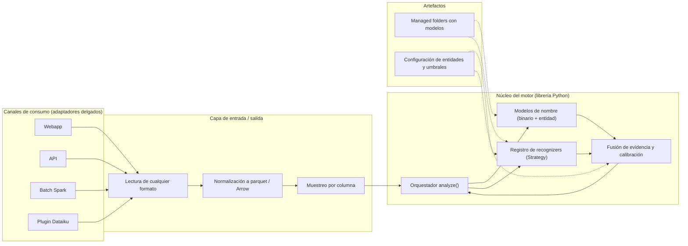
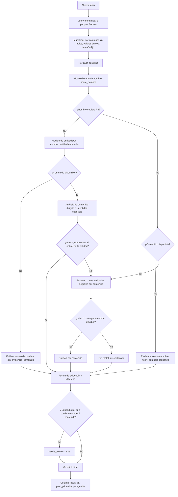
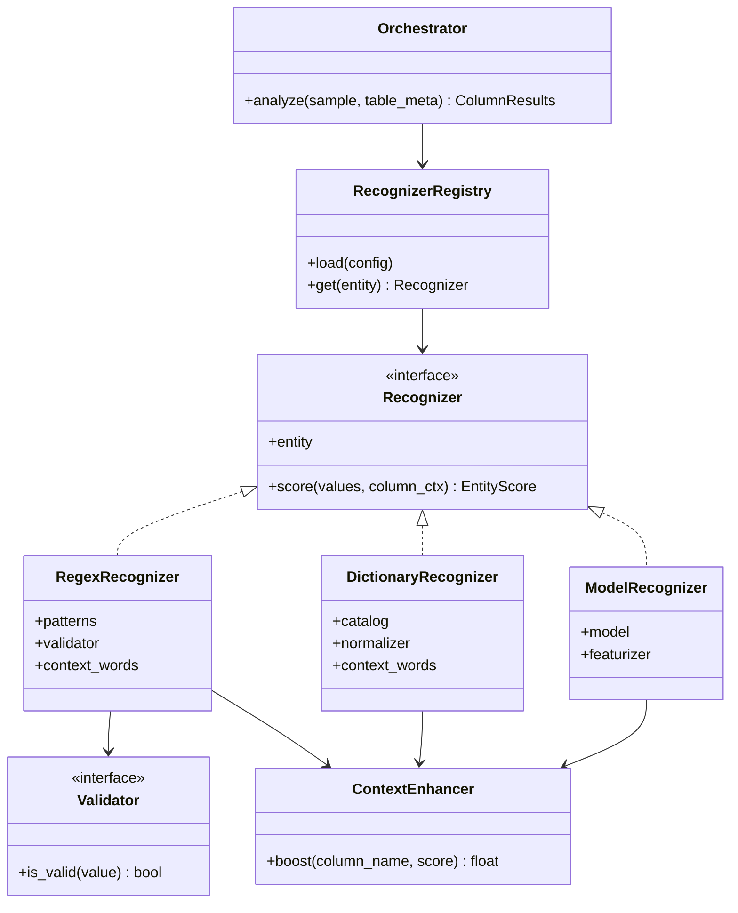
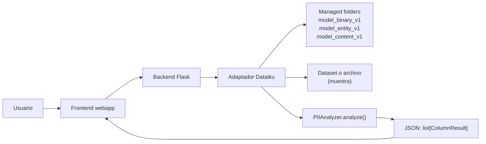
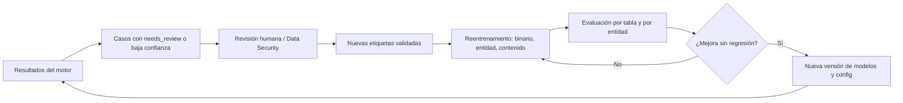

# Motor de detección e identificación de datos PII

| Campo | Valor |
|---|---|
| Estado | Borrador v0.3 (modelos entrenados + despliegue en webapp estándar) |
| Fecha | 2026-10-28 |
| Plataforma | Dataiku DSS (servidor sin acceso directo a internet, dependencias vía Artifactory) |
| Alcance | Análisis de tablas por nombre y contenido de columnas |
| Salida principal | `pii`, `prob_pii`, `entity`, `prob_entity` por columna |

---

## 1. Propósito

Desarrollar un **motor agnóstico de procesamiento, detección e identificación de datos PII** que, dada una tabla nueva, determine para cada columna:

- si contiene PII (`pii`) y con qué confianza (`prob_pii`);
- de qué tipo de entidad se trata (`entity`) y con qué confianza (`prob_entity`).

El análisis se basa en dos fuentes de evidencia:

1. **Nombre de la columna** (siempre disponible, incluso en producción cuando solo llegan metadatos).
2. **Contenido de la columna** (sobre una muestra de valores, cuando hay acceso a los datos).

### 1.1 Objetivos

- Detectar PII con alta precisión en tablas de millones de registros sin procesarlas completas.
- Funcionar igual en cualquier canal de consumo: webapp, API, batch (Spark) y plugin de Dataiku.
- Aceptar cualquier formato de tabla de entrada y procesarlo internamente de forma uniforme (parquet).
- Permitir agregar o ajustar entidades mediante configuración, sin cambiar el código del núcleo.
- Ser eficiente en recursos: sin Presidio ni spaCy en el camino crítico.

### 1.2 Fuera de alcance (por ahora)

- Uso de LLMs (no hay LLM Mesh ni modelos disponibles en la instancia).
- Descarga de modelos preentrenados desde internet (la instancia no tiene conexión directa).
- Remediación o enmascaramiento de los datos (el motor solo clasifica).

---

## 2. Restricciones y decisiones de diseño

| Decisión | Motivo |
|---|---|
| Sin Presidio ni spaCy | Alto consumo de recursos, inicialización pesada, modelo disponible solo en inglés y poco adecuados para valores sueltos de tabla |
| Polars como motor de datos | Eficiencia en memoria y velocidad para regex y operaciones columnares |
| Muestreo por columna | Se esperan tablas de millones de registros; el costo debe ser independiente del tamaño de la tabla |
| Formato interno parquet / Arrow | Un único formato de trabajo sin importar el formato de entrada |
| Patrón Strategy para recognizers | Cambiar o agregar regex, diccionarios o modelos por entidad desde configuración |
| PII determinístico → regex + validador | Entidades con estructura fija o dependiente de contexto (Grupos A y B: CURP, RFC, CLABE, NSS, tarjeta, teléfono, correo, `lugar_nacimiento`, etc.) |
| PII de catálogo cerrado → diccionario | Entidades con valores acotados (Grupo C: `nacionalidad`, `sexo`, `estado_civil`, `puesto`) |
| PII no determinístico → modelo de contenido | Entidades abiertas apoyadas en un modelo entrenado con catálogos (Grupo D: `nombre`, `apellido`, `direccion`, `empresa`) |
| PII ambiguo → revisión humana | Entidades sin estructura única agrupadas en `otro_pii` (Grupo E / Clasificación 2) |
| Núcleo independiente del canal | El mismo `analyze()` se usa desde webapp, API, Spark y plugin |
| Primer canal: webapp estándar de Dataiku | Es el canal priorizado; el backend resuelve los managed folders y llama al núcleo sin modificarlo |
| Artefactos en managed folders del flow | `model_binary_v1`, `model_entity_v1` y `model_content_v1`, cada uno con `model.pkl` y `report.html` |
| Configuración del modelo de contenido dentro del bundle | `labels`, `temperature`, `tau` y `theta` viajan en `model.pkl`; no hay `config.json` separado que el motor deba leer |
| Código del motor en Project Libraries | Solo el paquete `pii_engine` se carga en el Library Editor; los artefactos viven en `model_binary_v1`, `model_entity_v1` y `model_content_v1` |
| `lugar_nacimiento` por reglas de contenido | Grupo B: regex + catálogo de estados/países, con contexto de nombre recomendado; sin nombre se activa por contenido con `needs_review`; no es clase del modelo de contenido |
| Sin LLMs | No disponibles en la instancia |

---

## 3. Contrato de salida

Cada columna analizada produce un `ColumnResult`:

```json
{
  "table": "clientes_nuevos",
  "column": "tel casa1",
  "pii": true,
  "prob_pii": 0.97,
  "entity": "telefono",
  "prob_entity": 0.94,
  "evidence": "both",
  "match_rate": 0.91,
  "sample_size": 2000,
  "needs_review": false,
  "classification": 1,
  "engine_version": "0.1.0",
  "model_version": "bin:joblib,ent:joblib,content:v1",
  "config_version": "1.0",
  "schema_version": "1.0"
}
```

| Campo | Descripción |
|---|---|
| `pii` | Veredicto final (booleano) |
| `prob_pii` | Probabilidad calibrada de que la columna sea PII |
| `entity` | Tipo de PII (o `no aplica` si no es PII) |
| `prob_entity` | Confianza en la entidad asignada |
| `evidence` | Origen de la decisión: `name`, `content` o `both` |
| `match_rate` | Fracción de valores de la muestra que validaron la entidad |
| `sample_size` | Número de valores únicos no nulos analizados antes de la limpieza interna del modelo de contenido (el denominador efectivo puede ser menor al excluir `NULL_TOKENS`) |
| `needs_review` | `true` si requiere revisión humana (p. ej. `otro_pii`, conflictos nombre/contenido) |
| `classification` | 1 = entidad detectable por contenido con reglas/diccionario/modelo; 2 = ambigua, requiere revisión humana |
| `engine_version` | Versión del motor (`pii_engine`) |
| `model_version` | Versiones de los modelos utilizados (binario, entidad, contenido) |
| `config_version` | Versión de la configuración (`entities.yaml`, `thresholds.yaml`) |
| `schema_version` | Versión del contrato de salida |

> Los valores de la muestra **nunca** forman parte de la salida ni de los logs (ver sección 12).
>
> El motor compone `model_version` con los tags de los tres modelos. El tag de nombre usa `bin:joblib,ent:joblib` (o `bin:rules,ent:rules` si falta el artefacto) y el de contenido se toma del campo `model_version` del bundle (`content:v1` en la versión actual). El managed folder que lo contiene se llama `model_content_v1`; folder y versión interna se documentan por separado para trazabilidad de despliegue.
>
> La clase interna `otro` del modelo de contenido significa "ninguna de las cuatro entidades del Grupo D". **No** es `otro_pii` (Clasificación 2): `otro` no se reporta como `entity` ni activa `needs_review` por sí mismo.

---

## 4. Arquitectura

### 4.1 Vista por capas



### 4.2 Principios de la arquitectura

1. **El núcleo no lee archivos ni conoce el canal.** Recibe una muestra (`pl.DataFrame`) y metadatos de la tabla, y devuelve `list[ColumnResult]`.
2. **Los adaptadores son delgados.** Solo traducen entradas/salidas de cada canal:
   - *Webapp / API*: reciben el archivo o la referencia, muestrean y llaman a `analyze()`.
   - *Batch Spark*: Spark se usa solo para **extraer la muestra** de tablas grandes (o con `mapInPandas`/`applyInPandas` por tabla); el análisis corre con Polars sobre la muestra.
   - *Plugin / recipe de Dataiku*: lee el dataset de entrada y escribe el resultado como dataset.
3. **Spark no es dependencia del núcleo.** Con muestreo, el volumen analizado es pequeño y cabe en memoria.
4. **Todo es configurable.** Entidades, patrones, validadores, palabras de contexto y umbrales viven en configuración versionada.

### 4.3 Estructura de repositorio propuesta

```
pii_engine/
├── core/
│   ├── analyzer.py              # orquestador analyze()
│   ├── fusion.py                # fusión de evidencia y reglas de decisión
│   ├── sampling.py              # muestreo (nulos, únicos, tamaño fijo)
│   └── schema.py                # ColumnResult, TableMeta
├── recognizers/
│   ├── base.py                  # interfaz Recognizer (Strategy)
│   ├── regex_recognizer.py      # regex + validador + contexto (Grupos A y B)
│   ├── dictionary_recognizer.py # pertenencia a diccionario/catálogo (Grupo C)
│   ├── model_recognizer.py      # modelo de contenido (Grupo D)
│   ├── validators.py            # Luhn, CURP, RFC, CLABE, NSS...
│   ├── context.py               # refuerzo por nombre de columna
│   └── registry.py              # carga desde configuración
├── models/                      # solo para desarrollo/tests; en Dataiku viven en managed folders
|-- binary/                  # model_binary_v1/model.pkl
|-- entity/                  # model_entity_v1/model.pkl
`-- content/                 # model_content_v1/model.pkl
├── config/
│   ├── entities.yaml            # entidades, patrones, estrategia, clasificación
│   ├── thresholds.yaml          # umbrales y pesos de fusión
│   └── catalogs/                # catálogos cerrados (incluye lugar_nacimiento.txt)
├── adapters/
│   └── dataiku_adapter.py       # managed folders, dataset/archivo, health
├── tests/
└── docs/

webapp/
├── backend.py                   # Flask: /health, /analyze, /analyze-file
└── frontend.html                # UI de la webapp estándar
```

---

## 5. Algoritmo núcleo

### 5.1 Planteamiento original

Por cada tabla nueva: leer nombre → ¿PII? → entidad → análisis de contenido (regex/diccionario/modelo) → ¿coincide con el nombre? → PII; si no coincide, buscar entidad desde el contenido; si no hay match, no PII; y finalmente aplicar análisis de contenido a las columnas no PII.

### 5.2 Correcciones incorporadas

| # | Observación | Corrección |
|---|---|---|
| 1 | El caso "contenido no coincide con el nombre → buscar entidad por contenido" y el bloque final "analizar columnas no PII" ejecutan el mismo escaneo | Se unifican en un **escaneo contra las entidades candidatas por contenido** (respetando las restricciones de contexto de nombre obligatorio) |
| 2 | Se asignaba "no PII" a mitad del flujo | Cada etapa **acumula evidencia**; el veredicto se calcula al final en la fusión |
| 3 | El "match" era binario | Se usa `match_rate` (fracción de la muestra que valida) con umbral por entidad |
| 4 | Contenido vacío o todo nulo | No degrada a no PII: se conserva el score de nombre con `evidence = name` y baja confianza |
| 5 | Nombre y contenido apuntan a entidades distintas | Regla de prioridad: para entidades con dígito verificador gana el contenido; se marca `needs_review` si el conflicto persiste |
| 6 | `otro_pii` (clasificación 2) | Sale con `needs_review = true`, sin forzar una entidad |
| 7 | Columnas de texto libre | Se detectan primero (longitud media, número medio de tokens y proporción de valores largos) y se usa búsqueda sin anclas (`contains`) en lugar de coincidencia completa (`^...$`) |

### 5.3 Diagrama de flujo



> **Nota sobre el escaneo de entidades elegibles (`K`):** Cuando el nombre no sugiere PII (o no coincide con la entidad esperada), el escaneo evalúa las entidades del **Grupo A** (señal fuerte) y aquellas de los **Grupos B, C y D** cuyo contexto de nombre no sea *Obligatorio*. Las entidades de "solo nombre" (`cvv`, `pin_nip`, `saldo`, `credito`, `biometrico`) y aquellas con contexto *Obligatorio* nunca disparan PII únicamente por contenido. **Excepción:** las entidades con contexto *Obligatorio* y `allow_content_without_name: true` sí pueden disparar por contenido cuando la columna no tiene nombre (placeholder `Unnamed: N` o vacío), y la fusión las marca `needs_review`.
>
> **Política vigente:** `allow_content_without_name` no se habilita en ninguna entidad. Las 9 `required` (`fecha_nacimiento`, `fecha_vencimiento`, `licencia_conducir`, `cic`, `ocr`, `cuenta`, `cliente`, `contrato`, `nomina`) carecen de un validador fuerte y sus patrones se solapan entre sí. La cobertura por contenido sin nombre es **25/40** (11 del Grupo A + 6 del B + 4 del C + 4 del D); quedan fuera esas 9 `required`, las 5 `name_only` y `otro_pii`.
>
> **Nota sobre el modelo de contenido:** si el artefacto no está disponible, `ModelRecognizer` se abstiene sin interrumpir el motor; si la columna es numérica pura, el modelo de contenido no participa; y si la clase ganadora es `otro`, no hay match del Grupo D. En esos casos la decisión sigue las reglas de nombre/contenido de la tabla 5.4 y no se fuerza una entidad D.

### 5.4 Reglas de decisión

| Nombre | Contenido | Resultado | `evidence` |
|---|---|---|---|
| PII | Valida la entidad esperada | PII, entidad esperada | `both` |
| PII | No valida la esperada, valida otra elegible | PII, entidad del contenido; si es de otra familia, `needs_review` | `content` |
| PII | Hay contenido, ninguna entidad valida | No PII con probabilidad reducida; `needs_review` si `score_nombre` es alto | `content` |
| PII | Vacío / todo nulo | PII con baja confianza (`sin_evidencia_contenido`) | `name` |
| No PII | Valida alguna entidad elegible (sin contexto obligatorio, o con `allow_content_without_name` en columna sin nombre) | PII, entidad del contenido; `needs_review` si fue sin contexto | `content` |
| No PII | Hay contenido, ninguna entidad valida | No PII | `both` |
| No PII | Vacío / todo nulo | No PII con baja confianza (`sin_evidencia_contenido`) | `name` |
| `otro_pii` | Cualquiera | `needs_review = true`, sin entidad forzada | `name` |
| Cualquiera | Modelo de contenido = `otro` | Sin entidad del Grupo D; no es `otro_pii`; se resuelve con las reglas de nombre/contenido restantes | `content` |

> **Nota sobre `otro_pii`:** si la regla determinística de nombre coincide con `otro_pii` pero el modelo de entidad predice otra entidad y el contenido no valida ninguna entidad, el motor no fuerza `classification=2`; mantiene `pii=false` y fuerza `needs_review=true` para revisión humana.

### 5.5 Fusión de evidencia (propuesta a calibrar)

Cuando existe evidencia tanto de nombre como de contenido (`sample_size > 0`):

```
prob_pii = calibrar( w0 + w1 · logit(clip(score_nombre, ε, 1-ε)) + w2 · logit(clip(match_rate_ajustado, ε, 1-ε)) + w3 · bonus_validador )
```

- Se aplica suavizado/acotamiento `clip(p, ε, 1 - ε)` (p. ej. `ε = 1e-4`) para evitar indeterminaciones en `logit(0)` o `logit(1)`.
- Cuando no hay contenido disponible (`sample_size == 0`, `evidence = name`), el término de contenido se omite y `prob_pii` se calcula únicamente a partir de `score_nombre` penalizado por falta de cobertura.
- `match_rate_ajustado` considera el tamaño de la muestra (con pocas muestras se penaliza).
- Para el **Grupo D**, la decisión de columna se toma con `aggregate_column(tau, theta)` sobre las probabilidades calibradas por temperatura: cada valor vota por su clase si `p >= tau`; la cobertura es la fracción de votos; se acepta la clase con cobertura `>= theta` y, si ninguna, se devuelve `otro`. El bundle de `model_content_v1` fija **`tau = 0.50` y `theta = 0.30`**; `temperature` también viaja en el bundle. `match_rate` se reporta como la cobertura de la clase ganadora.
- El motor carga el bundle una sola vez por columna (con caché por valores), aplica `temperature`, ejecuta la agregación `tau/theta` y se abstiene sin forzar entidad cuando la clase ganadora es `otro`. Si el contexto del nombre no refuerza la entidad (`context_mode: recommended`), el score se penaliza después de la agregación.
- La implementación vigente todavía usa `value_prob_threshold = 0.50` y `score = 0.65 · match_rate + 0.35 · mean_prob` sin consumir `temperature`, `tau` ni `theta`; es la brecha principal a cerrar en la Fase 3 (sección 18).
- `bonus_validador` aplica cuando el valor pasa un dígito verificador (CURP, CLABE, Luhn, RFC, NSS, IBAN).
- Los pesos se calibran con un conjunto de columnas reales etiquetadas (ver sección 9). Mientras no exista, se puede empezar con reglas ponderadas y umbrales por entidad.

---

## 6. Muestreo

| Aspecto | Criterio |
|---|---|
| Qué se muestrea | Dos niveles: (1) **filas** de la tabla, con reservoir uniforme; (2) **valores no nulos y distintos** por columna (deduplicar antes con `n_unique` en Polars). El modelo de contenido descarta además `NULL_TOKENS` (`null`, `n/a`, `sin dato`, `-`, `0`, etc.) antes de puntuar |
| Tamaño | Filas: **2% dinámico** del total del dataset (`ceil(total * row_ratio)`), configurable con `row_ratio: 0.02`; `row_min_rows` y `row_max_rows` son opcionales y por defecto `null` (sin límites). Por columna: **sin tope fijo** por defecto (`default_sample_size: null`), se usan todos los valores únicos no nulos de las filas muestreadas. La calibración de `tau/theta` del modelo de contenido se hizo con 200 valores por columna y quedó en `tau=0.50`, `theta=0.30`; si se fija un tope por columna, revisar esos umbrales |
| Dónde se muestrea | Filas: en el adaptador de entrada (`PIIAdapter` con `LocalSourceReader`/`DataikuSourceReader`), sin depender del muestreo nativo de Dataiku; CSV/parquet se recorren por chunks (memoria O(k)) y, para el ratio, se cuenta el total en una primera pasada. Columnas: en el núcleo |
| Modo | `random` por defecto (uniforme, semilla 42); `head` disponible por compatibilidad (`sampling_mode`) |
| Cobertura | Se reporta `sample_size` en la salida |
| Texto libre | Se detecta el tipo de columna y se aplica `contains`; se documenta que el muestreo puede no capturar PII poco frecuente |
| Reproducibilidad | Semilla configurable (`sampling_seed` para filas, `seed` para columnas) |

---

## 7. Recognizers: patrón Strategy

### 7.1 Diseño



### 7.2 Funciones a medida

- **Recognizers**: construyen el score por entidad a partir de la muestra (mediante regex, diccionario o modelo).
- **Validadores**: dígitos verificadores y reglas estructurales (Luhn para tarjetas, CURP, RFC con homoclave, CLABE, NSS, IBAN).
- **Diccionarios**: catálogos cerrados normalizados en memoria (`set`/`frozenset` en Polars `is_in`) para entidades del Grupo C (`nacionalidad`, `sexo`, `estado_civil`, `puesto`).
- **Contexto**: refuerzan o reducen el score según el nombre de la columna (un número de 10 dígitos en `tel_casa` vale más que en `campo_auxiliar`), o exigen coincidencia cuando el contexto es obligatorio.
- **Constructor de regex a medida**: funciones para componer expresiones (bloques reutilizables: fechas, dígitos, alfabeto con acentos, separadores opcionales).

### 7.3 Ejemplo de configuración (`entities.yaml`)

```yaml
version: "1.0"

entities:
  clabe:
    classification: 1
    group: A
    strategy: regex
    patterns:
      - '^\d{18}$'
    validator: clabe_checksum
    context_words: [clabe, interbancaria, cuentaclabe, clabe dest]
    context_mode: optional          # none | optional | recommended | required | name_only
    min_match_rate: 0.60

  estado_civil:
    classification: 1
    group: C
    strategy: dictionary
    catalog: catalogs/estado_civil.txt
    context_words: [estado civil, edo civil, est civil, marital]
    context_mode: recommended
    min_match_rate: 0.65

  nombre:
    classification: 1
    group: D
    strategy: model
    model: model_content_v1      # managed folder del flow; el adaptador resuelve la ruta
    bundle_labels: [apellido, direccion, empresa, nombre, otro]
    tau: 0.50                   # leído del bundle; aquí solo como referencia
    theta: 0.30                 # leído del bundle; aquí solo como referencia
    context_words: [nombre, name, nm, nomcte, beneficiario, titular, nom]
    negative_context_words: [apellido, apepat, apemat, empresa, razon social]
    context_mode: recommended
    min_match_rate: 0.50

  lugar_nacimiento:
    classification: 1
    group: B
    strategy: dictionary
    catalog: catalogs/lugar_nacimiento.txt  # 32 estados + abreviaturas + países/ISO
    context_words: [lugar nac, pais nac, ciudad nac, entidad nac, edo nac, estado nac, municipio nac, birth place, place of birth]
    context_mode: recommended        # puede activarse por contenido; el contexto desempata ante direccion/empresa
    min_match_rate: 0.55

  otro_pii:
    classification: 2
    group: E
    strategy: none
    needs_review: true
```

> El esquema real usa `context_mode` (no `context_required`). La referencia `model: model_content_v1` es el managed folder del flow; el adaptador de Dataiku lo resuelve a su `model.pkl`. La configuración del modelo (`labels`, `temperature`, `tau`, `theta`, `model_version`) vive **dentro del bundle**, no en un `config.json` aparte. Las 5 clases del bundle son `apellido`, `direccion`, `empresa`, `nombre` y `otro`; `otro` es interna y no se reporta como entidad.
>
> El flag `allow_content_without_name: true` permite que una entidad con `context_mode: required` se evalúe por contenido cuando la columna es un placeholder (`Unnamed: N` o vacía), marcando `needs_review`. Está disponible para entidades `required`; `codigo_postal` y `geid` usan `context_mode: recommended` para detectarse con cualquier nombre.
>
> **Validación:** `RecognizerRegistry` rechaza `allow_content_without_name: true` si la entidad no usa estrategia `regex`, no tiene `context_mode: required` o no define un `validator`. En la configuración actual ninguna entidad habilita el flag: las 9 `required` no tienen validador fuerte y se mantienen bloqueadas sin nombre.

### 7.4 Rendimiento

- Aplicar el regex con Polars (`str.contains`) sobre toda la muestra de una vez: usando patrones anclados (`^...$`) para columnas estructuradas y patrones sin anclas para columnas detectadas como texto libre.
- Evaluar diccionarios del Grupo C de forma vectorizada con Polars (`str.to_lowercase().is_in(catalogo)`).
- Ejecutar los validadores **solo** sobre los valores que hicieron match en la expresión regular.
- Compilar los patrones y cargar los catálogos una sola vez al inicializar el registro (`RecognizerRegistry`).
- **Resolución de nombres en dos etapas:** el modelo binario corre para todas las columnas; el modelo de entidad solo se ejecuta para columnas que el binario marca como PII y que no resuelve el fast path regex (CURP, RFC, NSS, correo, CLABE, etc.). Las predicciones se cachean por nombre normalizado con LRU (`name_resolution.cache_size`).
- **Contenido en una sola pasada:** `ContentModelScorer` cachea por `(modelo, valores limpiados)` y ejecuta `predict_proba` una vez por columna; las 4 entidades D reutilizan las mismas probabilidades y la agregación `tau/theta`. Los valores `NULL_TOKENS` se descartan y los mayores a 120 caracteres se truncan, igual que en entrenamiento.

---

## 8. Modelos

| Modelo | Nivel | Tipo | Entrada | Estado |
|---|---|---|---|---|
| Binario de nombre | Nombre de columna | Regresión logística + TF-IDF (calibración isotónica) / LightGBM | Nombre de columna normalizado | Entrenado y disponible en `model_binary_v1` (`recipe_binary_v1.py`) |
| Entidad de nombre | Nombre de columna | Ensamble Híbrido Especializado multiclase (40 entidades, incluida `otro_pii`) con calibración por temperatura | Nombre de columna normalizado | Entrenado y disponible en `model_entity_v1` (`recipe_entity_v1.py`) |
| Contenido | Valores de la muestra | TF-IDF de caracteres/palabras + regresión logística calibrada por temperatura + rasgos de forma (4 entidades del Grupo D + clase interna `otro`) | Valores de la columna | Integrado en `ModelRecognizer`; el bundle de `model_content_v1` aporta `labels`, `temperature`, `tau=0.50`, `theta=0.30` y `model_version` |

### 8.1 Línea base del modelo binario de nombre (primer entrenamiento)

| Métrica | Valor |
|---|---|
| Filas de entrenamiento | 213,912 (41.9% PII) |
| Tablas | 8,894 |
| Nombres en conflicto | 330 |
| F1 fuera de muestra (GroupKFold 5), global | 0.973 |
| F1 en nombres no vistos (13% de las filas, 4.8% PII) | 0.389 |
| Umbral | 0.409 |

La brecha entre el F1 global y el de nombres no vistos es el principal punto de mejora y justifica incorporar el análisis de contenido.

### 8.2 Modelo de contenido

#### Objetivo y clases

Clasifica las **4 entidades no determinísticas del Grupo D**: `nombre` (cubre nombre de pila y nombre completo), `apellido`, `direccion` y `empresa` (organización), más una clase interna `otro` que representa "ninguna de las cuatro".

- `otro` **no** es `otro_pii`: no se reporta como `entity` ni activa `needs_review` por sí mismo.
- `puesto` se evalúa mediante diccionario de valores en el Grupo C.
- `lugar_nacimiento` salió del modelo y se analiza con regex + catálogo en el Grupo B (secciones 11.2 y 11.4).

#### Datos de entrenamiento

- `generate_otro_recipe.py` toma `training_dataset` (`value`, `type` con las 4 clases D) y produce `training_dataset_with_otro`.
- `recipe_content_v1.py` entrena sobre `training_dataset_final_mc` (`value`, `type`), que ya incluye la clase `otro`.
- Catálogos locales (`PER`: nombres y apellidos frecuentes; `DIR`: asentamientos y vialidades; `ORG2`: organizaciones) combinados con datos sintéticos y ejemplos reales alimentan el **dataset**; no se consultan en inferencia. El gazetteer `LUG` (AGEEML) ya no alimenta el modelo.
- `otro` se genera con 8 familias (catálogo, producto, concepto, número, fecha, código, entidades ya cubiertas por regex y texto libre), con un tamaño aproximado de `OTRO_RATIO=2.0` veces el promedio de las clases positivas. El estilo (mayúsculas/minúsculas/título) y la proporción de acentos se igualan a los de las clases positivas para evitar atajos de formato.
- Los **negativos difíciles** son imprescindibles: nombres de productos, catálogos operativos, códigos internos y descripciones cortas.

#### Preprocesado

- `canonical`: normalización NFKD, sin acentos, minúsculas y espacios colapsados.
- Deduplicación por (`canonical(value)`, `type`).
- Se descartan vacíos y valores con longitud `> MAX_VALUE_LEN=120`.
- `normalize_text`: `canonical` + cada dígito reemplazado por `0`, para que el modelo no dependa de números concretos ni de mayúsculas/acentos.

#### Features

- TF-IDF `char_wb` de 2 a 5 caracteres (400,000 features máx.), `sublinear_tf`.
- TF-IDF de palabras 1 a 2 (100,000 features máx.), `min_df=3`, `sublinear_tf`.
- 8 rasgos de forma: `log_len`, `n_tokens`, `mean_token_len`, `digit_ratio`, `alpha_ratio`, `punct_ratio`, `n_digit_groups`, `has_comma`, escalados con `MaxAbsScaler`.
- **No** hay rasgos de mayúsculas iniciales ni de pertenencia a gazetteer.

#### Modelo

`LogisticRegression(C=4.0, class_weight="balanced", max_iter=300)` sobre la unión de features.

#### Validación

- `StratifiedGroupKFold` de 5 folds agrupando por el token alfabético más largo del valor: el test contiene nombres/calles/empresas con léxico no visto en train.
- Prueba de robustez con ruido (`STRESS_NOISE_P=0.5`): typos, truncado y letra duplicada; se reporta macro-F1 con ruido.

#### Calibración

- Escalado por temperatura sobre las probabilidades out-of-fold: `apply_temperature(proba, T)`.
- Se reportan logloss y ECE antes y después; la temperatura se guarda en el bundle `model.pkl`.

#### Agregación por columna

`aggregate_column(proba, labels, tau, theta)` decide la entidad de una columna:

1. Cada valor vota por su clase si `p >= tau`.
2. La cobertura de una clase es la fracción de valores que votan por ella.
3. Se acepta la clase con cobertura `>= theta`; si ninguna llega, se devuelve `otro`.

`tau` y `theta` se eligen por simulación de columnas: 200 valores por columna, 300 columnas por clase, purezas 1.0/0.8/0.6 (fracción de la clase real), selección con pureza 0.8 y `otro_fpr <= 0.01`.

> Valores vigentes en `model_content_v1`: **`tau = 0.50`**, **`theta = 0.30`** y `temperature` ajustada en entrenamiento. Los tres valores viajan dentro del bundle `model.pkl`.
>
> El motor actual usa una aproximación (`value_prob_threshold=0.50`, `score = 0.65·match_rate + 0.35·mean_prob`) y **aún no consume** `tau`, `theta` ni `temperature` del bundle. Es una brecha conocida (sección 18).

#### Artefactos

El managed folder `model_content_v1` publica **solo dos artefactos**: `model.pkl` y `report.html`. El bundle `model.pkl` contiene `model`, `classes` (alias de `labels`), `labels`, `other_label`, `temperature`, `tau`, `theta`, `model_version`, `column_sample_size`, `feature_module`, `model_file`, `libs` y `hyperparameters`. No se publican `config.json`, `metrics.json`, `classification_report.csv`, `confusion_matrix.csv`, `column_level_grid.csv`, `top_features.csv` ni `oof_errors.csv`; las métricas y gráficas quedan consolidadas en `report.html`.

> Los artefactos `model_binary_v1/model.pkl`, `model_entity_v1/model.pkl` y `model_content_v1/model.pkl` usan cloudpickle by-value: no requieren `pii_utils.py`, `pii_entity_model.py` ni `pii_content_features.py` en Project Libraries.

#### Riesgos y limitaciones

- Diferencia entre datos sintéticos/catálogos y datos sucios reales.
- Valores `>120` caracteres se descartan en entrenamiento; la inferencia actual no los trunca.
- La selección de `tau/theta` se hizo con 200 valores por columna; el motor muestrea 2,000 por defecto.
- `NULL_TOKENS` reduce el denominador efectivo del `match_rate`.
- `report.html` contiene el Top 50 de errores OOF con valores reales (ver sección 12).

### 8.3 Métricas del modelo de contenido

| Nivel | Métrica | Artefacto |
|---|---|---|
| Valor | accuracy, macro-F1, weighted-F1 y macro-F1 con ruido | `report.html` |
| Valor | precision, recall y F1 por clase | `report.html` |
| Valor | matriz de confusión absoluta y normalizada | `report.html` |
| Calibración | logloss y ECE antes/después de temperatura | `report.html` |
| Columna | macro-F1 y `otro_fpr` por combinación `tau`/`theta`/pureza | `report.html` |
| Columna | `tau`, `theta`, recalls por clase y supuestos de selección | `report.html` |
| Diagnóstico | features con más peso por clase y errores OOF más confiados | `report.html` |

> **Pendiente:** insertar aquí los valores reales del `report.html` de `model_content_v1`. No se documentan cifras sin el artefacto.
>
> **Seguridad:** el reporte incluye una sección "Errores Más Confiados en OOF (Top 50)" con **valores reales**. Debe restringirse o anonimizarse antes de compartir el managed folder (sección 12).

---

## 9. Evaluación

| Aspecto | Criterio |
|---|---|
| Unidad de evaluación | **Columna** para la decisión final; el modelo de contenido se evalúa además a nivel **valor** |
| Particiones | Modelos de nombre: por tabla/dataset (GroupKFold) para evitar fuga. Modelo de contenido: `StratifiedGroupKFold` por token alfabético más largo, para que el test tenga léxico no visto |
| Métricas | Nombre: precisión, recall y F1 por entidad, PR-AUC del binario y calibración. Contenido: macro-F1, weighted-F1, F1 con ruido, logloss/ECE a nivel valor; macro-F1, `otro_fpr` y recall por clase a nivel columna |
| Subconjuntos críticos | Nombres no vistos, entidades con pocos ejemplos, texto libre, valores con ruido y columnas con pureza 0.8 |
| Pendiente principal | Un **conjunto de evaluación de columnas reales con contenido**; el modelo de contenido se entrena y valida con valores sintéticos, de catálogo y algunos reales |
| Etiquetado | Etiquetas validadas por Data Security cuando se reciban; las entidades asignadas internamente se tratan como no validadas |

---

## 10. Artefactos

### 10.1 Datasets de entrenamiento

| Dataset | Tamaño | Notas |
|---|---|---|
| `dataset_no_validated` | ~267k | ~52% false / 48% true; etiquetas sin validar; se depura con las reglas de entidad (`no aplica`) |
| `dataset_validated_1` | ~21k | ~96% false / 4% true; incluye columna `entity` asignada internamente (no validada por Data Security) |
| `dataset_validated_2` | ~117k | ~15k con etiqueta tras limpieza |
| `dataset_validated_stacked` | — | Unión validada: `dataset`, `name`, `pii`, `entity` |
| `training_dataset_with_otro` | — | Dataset de valores (`value`, `type`) para el modelo de contenido: 4 clases del Grupo D + `otro`; generado por `generate_otro_recipe.py` |

### 10.2 Modelos y carpetas (Dataiku managed folders)

| Artefacto | Contenido |
|---|---|
| `model_binary_v1` | Managed folder del flow. Modelo binario por nombre de columna: `model.pkl` + `report.html` (métricas y matriz de confusión) |
| `model_entity_v1` | Managed folder del flow. Modelo multiclase de entidad por nombre (40 clases): `model.pkl` + `report.html` |
| `model_content_v1` | Managed folder del flow. Modelo de contenido (4 entidades del Grupo D + `otro`): `model.pkl` (bundle con `labels`, `temperature`, `tau=0.50`, `theta=0.30`, `model_version`) + `report.html`. El motor recibe la ruta del artefacto resuelta por el adaptador |
| Carpeta de configuración | `entities.yaml`, `thresholds.yaml` versionados en el repositorio y cargados desde Project Libraries |

### 10.3 Code recipes / scripts

Recipe vigente del modelo de contenido: `recipe_content_v1.py` (entrena, calibra, simula columnas y escribe `model_content_v1/model.pkl` + `report.html`).

| Recipe | Entrada | Salida |
|---|---|---|
| Entrenamiento binario | Dataset de entrenamiento | Managed folder con modelo, métricas y matriz de confusión |
| Entrenamiento de entidad | Mismo dataset | Managed folder del modelo multiclase |
| Entrenamiento de contenido | `training_dataset_final_mc` | Managed folder `model_content_v1` con `model.pkl` (bundle + configuración) y `report.html` |
| Inferencia por lotes | Tabla / metadatos nuevos | Dataset con `ColumnResult` (fase posterior a la webapp) |
| Generación de `otro` | `training_dataset` (4 clases D) | `training_dataset_with_otro` con ejemplos sintéticos y negativos (`generate_otro_recipe.py`) |

### 10.4 Entorno (code env)

Dependencias del motor y de los artefactos: `polars`, `scikit-learn`, `scipy`, `numpy`, `pandas`, `joblib`, `cloudpickle`, `lightgbm`, `PyYAML`, `faker` y `dataiku`. `matplotlib` es opcional (matriz de confusión). Candidatas para fases posteriores: `rapidfuzz`, `cleanlab`, `optuna`, `shap`, `symspellpy`, `gensim` y `fasttext-wheel`. Todas se instalan desde Artifactory.

En **Project > Libraries > python** del proyecto de Dataiku deben quedar:

- `pii_engine/` (paquete completo, incluidos `config/entities.yaml`, `config/thresholds.yaml` y `config/catalogs/`).


El motor solo requiere `pii_engine/` en Library Editor. Los artefactos `model.pkl` son autocontenidos y no dependen de módulos custom. El code env debe incluir `cloudpickle` y `lightgbm`.

### 10.5 Documentación y pruebas

- Este documento, versionado junto al repositorio.
- Catálogo de entidades (sección 11).
- Pruebas unitarias de validadores, regex y reglas de fusión; pruebas de regresión con un conjunto fijo de columnas.

### 10.6 Despliegue en Dataiku: webapp estándar

El primer canal de consumo es una **webapp estándar** de Dataiku (frontend HTML/JS + backend Python/Flask). El backend es un adaptador delgado: no contiene lógica de detección, solo resuelve entradas, modelos y salida.



Responsabilidades del backend:

1. **Resolver los managed folders** `model_binary_v1`, `model_entity_v1` y `model_content_v1`.
   - Si el folder expone ruta local (`get_path()`), pasar la ruta del artefacto al motor.
   - Si no, descargar cada artefacto a un directorio temporal y pasar la ruta del archivo.
   - No copiar modelos al repositorio ni al código de la webapp.
2. **Construir el analizador** con `PIIAnalyzer(binary_model_bundle=..., entity_model_bundle=..., content_model_path=...)`, apuntando el modelo de contenido al `model.pkl` resuelto.
3. **Leer la entrada**: dataset por nombre (`dataiku.Dataset(...).get_dataframe(...)`) o archivo CSV/parquet subido. Aplicar el muestreo del motor; nunca materializar tablas completas en la webapp.
4. **Responder solo metadatos**: `[r.to_dict() for r in results]`, con `pii`, `prob_pii`, `entity`, `prob_entity`, `evidence`, `match_rate`, `sample_size`, `needs_review`, `classification` y versiones. Ningún valor de la muestra viaja al frontend ni a los logs.

Endpoints mínimos:

| Método | Ruta | Entrada | Salida |
|---|---|---|---|
| `GET` | `/health` | — | Estado, `engine_version`, versiones de modelos y configuración |
| `POST` | `/analyze` | Nombre de dataset y lista opcional de columnas | `list[ColumnResult]` |
| `POST` | `/analyze-file` | CSV/parquet (muestra) | `list[ColumnResult]` |

Implementación en el repositorio:

| Archivo | Responsabilidad |
|---|---|
| `pii_engine/adapters/local_adapter.py` | Adaptador sin Dataiku: lectores CSV/parquet/Excel con reservoir y `analyze_dataframe`/`analyze_file`. |
| `pii_engine/adapters/dataiku_adapter.py` | Resuelve managed folders (`get_path` o descarga temporal), construye el analizador, compone `LocalAdapter` y lee datasets del flow con reservoir; expone `health()`. |
| `webapp/backend.py` | Flask: `/health`, `/analyze`, `/analyze-file`; valida entradas y serializa solo metadatos. Usa el `app` inyectado por DSS o crea uno local. |
| `webapp/frontend.html` | Frontend HTML/JS listo para la pestaña Frontend; usa `getWebAppBackendUrl()` y no muestra valores. |

Variables de entorno opcionales del backend: `PII_BINARY_FOLDER` (default `model_binary_v1`), `PII_ENTITY_FOLDER` (`model_entity_v1`), `PII_CONTENT_FOLDER` (`model_content_v1`), `PII_MODEL_FILENAME` (`model.pkl`), `PII_SAMPLE_RATIO` (`0.02`), `PII_SAMPLE_MIN_ROWS` (sin mínimo), `PII_MAX_READ_ROWS` (sin máximo; tope opcional), `PII_SAMPLING_MODE` (`random`; alternativa `head`), `PII_SAMPLE_SEED` (`42`) y `PII_MAX_UPLOAD_MB` (`0`, sin límite; acepta `none`/`unlimited`).

Notas de despliegue:

- La webapp usa el mismo code env que el motor (`polars`, `scikit-learn`, `joblib`, `PyYAML`, `dataiku`, etc.).
- Solo `pii_engine/` debe estar cargado en Project Libraries; los modelos se resuelven desde sus managed folders `model_binary_v1`, `model_entity_v1` y `model_content_v1`.
- En DSS: pegar `webapp/backend.py` en la pestaña Python y `webapp/frontend.html` en la pestaña Frontend; el backend detecta el `app` inyectado por DSS.
- La UI puede mostrar `model_version` y `config_version` por columna para trazabilidad.
- El análisis es por muestreo; la webapp no requiere Spark en esta fase.

---

## 11. Catálogo de entidades

El catálogo vigente consta de **40 entidades** (39 en **Clasificación 1** detectables por contenido mediante regex, diccionario o modelo, y 1 en **Clasificación 2**, `otro_pii`, orientada a revisión humana). Las reglas base de asignación por nombre de columna se encuentran en `regex.txt` y el detalle de validación en `tabla_entidades_pii.md`.

### 11.1 Resumen por estrategia de contenido

| Grupo | Estrategia de contenido | Clasificación | N.º de entidades |
|---|---|---:|---:|
| **A** | Regex + validador (señal fuerte) | 1 | 11 |
| **B** | Regex débil o dependiente del contexto | 1 | 20 |
| **C** | Diccionario de valores | 1 | 4 |
| **D** | Modelo de contenido | 1 | 4 |
| **E** | Validación humana (`otro_pii`) | 2 | 1 |
| | **Total** | | **40** |

### 11.2 Detalle de las 40 entidades

#### Grupo A — Regex + validador (señal fuerte, 11 entidades)

| # | Entidad | Clasificación | Método de contenido | Validador | Contexto de nombre | Nivel de sensibilidad |
|---:|---|---:|---|---|---|---|
| 1 | `curp` | 1 | Regex de 18 caracteres | Fecha válida, entidad federativa, dígito verificador | Opcional | Confidential PII |
| 2 | `rfc` | 1 | Regex de 12 o 13 caracteres | Fecha válida, dígito verificador / homoclave | Opcional | Confidential PII |
| 3 | `clave_elector` | 1 | Regex de 18 caracteres | Fecha embebida, entidad, sexo H/M | Opcional | Confidential PII |
| 4 | `clabe` | 1 | 18 dígitos | Dígito verificador y código de banco en catálogo | Opcional | Confidential PII |
| 5 | `iban` | 1 | País (2 letras) + 2 dígitos + alfanumérico | Módulo 97 (ISO 13616) | Opcional | Confidential PII |
| 6 | `tarjeta` | 1 | 13 a 19 dígitos | Algoritmo de Luhn y rango BIN | Opcional | Confidential PII |
| 7 | `correo` | 1 | Regex de correo electrónico | Dominio y estructura válida | No | Internal PII |
| 8 | `ip` | 1 | Formato IPv4 / IPv6 | Validación con librería `ipaddress` | No | Internal PII |
| 9 | `coordenadas` | 1 | Decimales latitud / longitud | Rangos válidos (±90° / ±180°) | Sí (evita decimales genéricos) | Internal PII |
| 10 | `ssn` | 1 | `###-##-####` (9 dígitos) | Descartar prefijos 000, 666 y 9xx | Sí (si viene sin guiones) | Confidential PII |
| 11 | `nss` | 1 | 11 dígitos | Subdelegación, año y dígito verificador IMSS | Sí (11 dígitos colisionan) | Confidential PII |

#### Grupo B — Regex débil o dependiente del contexto (20 entidades)

| # | Entidad | Clasificación | Método de contenido | Validador | Contexto de nombre | Nivel de sensibilidad |
|---:|---|---:|---|---|---|---|
| 12 | `telefono` | 1 | 10 dígitos (+52 opcional) | Descartar secuencias y dígitos repetidos | Sí | Internal PII |
| 13 | `codigo_postal` | 1 | 5 dígitos | Catálogo SEPOMEX / rango válido | Recomendado (por contenido con `needs_review`; el contexto del nombre refuerza) | Internal PII |
| 14 | `fecha_nacimiento` | 1 | Fecha | Edad plausible (0 a 110 años) | Obligatorio | Confidential PII |
| 15 | `fecha_vencimiento` | 1 | Fecha o formato `MM/AA` | Fecha futura o vigencia cercana | Obligatorio | Confidential PII |
| 16 | `pasaporte` | 1 | Alfanumérico (p. ej. 1 letra + 8 dígitos, por confirmar) | Longitud y formato | Sí | Confidential PII |
| 17 | `licencia_conducir` | 1 | Alfanumérico (varía por estado) | Longitud / formato | Obligatorio | Confidential PII |
| 18 | `soeid` | 1 | Patrón interno (`[a-z]{2}\d{5}`) | Longitud y prefijo de letras | Sí | Internal PII |
| 19 | `geid` | 1 | Patrón numérico interno (10 dígitos, por confirmar) | Longitud | Recomendado (por contenido con `needs_review`; el contexto del nombre refuerza) | Internal PII |
| 20 | `cic` | 1 | 9 dígitos (INE, por confirmar) | Longitud | Obligatorio | Confidential PII |
| 21 | `ocr` | 1 | 12 o 13 dígitos (INE/IFE, por confirmar) | Longitud | Obligatorio | Confidential PII |
| 22 | `cuenta` | 1 | Numérico de longitud fija | Longitud | Obligatorio | Confidential PII |
| 23 | `cliente` | 1 | ID numérico | Tipo de dato y cardinalidad | Obligatorio | Internal PII |
| 24 | `contrato` | 1 | ID numérico o alfanumérico | Tipo de dato | Obligatorio | Confidential Information (con revisión) |
| 25 | `nomina` | 1 | ID numérico de empleado/nómina | Tipo de dato | Obligatorio | Internal PII |
| 26 | `cvv` | 1 | 3 o 4 dígitos | Solo tipo de dato | Obligatorio (solo nombre) | Confidential PII |
| 27 | `pin_nip` | 1 | 4 a 6 dígitos | Solo tipo de dato | Obligatorio (solo nombre) | Confidential PII |
| 28 | `saldo` | 1 | Numérico con decimales (montos, ingresos, límites) | Solo tipo de dato | Obligatorio (solo nombre) | Confidential PII |
| 29 | `credito` | 1 | Numérico (número o línea de crédito/préstamo) | Solo tipo de dato | Obligatorio (solo nombre) | Confidential PII |
| 30 | `biometrico` | 1 | Blob, base64 o hash largo (huella, biometría) | Longitud y formato binario/texto | Obligatorio (solo nombre) | Sensitive PII |
| 31 | `lugar_nacimiento` | 1 | Catálogo de estados de México (nombres + abreviaturas), ciudades y países/ISO, ver sección 11.4 | Pertenencia al catálogo `catalogs/lugar_nacimiento.txt` | Recomendado (se activa por contenido con `needs_review`; el contexto desempata ante `direccion`, `nacionalidad` y `empresa`) | Internal PII |

#### Grupo C — Diccionario de valores (4 entidades)

| # | Entidad | Clasificación | Método de contenido | Validador | Contexto de nombre | Nivel de sensibilidad |
|---:|---|---:|---|---|---|---|
| 32 | `nacionalidad` | 1 | Diccionario de gentilicios y países (ISO) | Pertenencia al catálogo | Sí | Sensitive PII |
| 33 | `sexo` | 1 | Diccionario (`H`/`M`, `F`/`M`, `hombre`/`mujer`, `masculino`/`femenino`) | Pertenencia al catálogo | Sí | Sensitive PII |
| 34 | `estado_civil` | 1 | Diccionario (`soltero`, `casado`, `viudo`, `divorciado`, `unión libre`, etc.) | Pertenencia al catálogo | Sí | Internal PII |
| 35 | `puesto` | 1 | Diccionario / catálogo de puestos, roles, ejecutivos y ocupaciones | Pertenencia al catálogo | Sí | Internal PII |

#### Grupo D — Modelo de contenido (4 entidades)

| # | Entidad | Clasificación | Método de contenido | Validador | Contexto de nombre | Nivel de sensibilidad |
|---:|---|---:|---|---|---|---|
| 36 | `nombre` | 1 | Modelo de contenido (entrenado con catálogo `PER`; cubre nombre de pila y nombre completo) | Score del modelo sobre la muestra | Sí (para separarlo de `apellido`) | Internal PII |
| 37 | `apellido` | 1 | Modelo de contenido (entrenado con catálogo de apellidos `surnames_freq_ge_100.csv`) | Score del modelo sobre la muestra | Sí (para separarlo de `nombre`) | Internal PII |
| 38 | `direccion` | 1 | Modelo de contenido (entrenado con catálogo `DIR` y pistas léxicas: `calle`, `núm.`, `col.`, `C.P.`) | Score del modelo sobre la muestra | Sí | Internal PII |
| 39 | `empresa` | 1 | Modelo de contenido (entrenado con catálogo `ORG2` y sufijos societarios: `S.A. de C.V.`, `S.C.`, etc.) | Score del modelo sobre la muestra | Sí | Internal Information (con revisión) |

> El bundle `model_content_v1` tiene 5 clases: `apellido`, `direccion`, `empresa`, `nombre` y `otro`. La clase `otro` es interna y no se reporta. La agregación por columna usa `tau=0.50` y `theta=0.30`.

#### Grupo E — Validación humana (1 entidad)

| # | Entidad | Clasificación | Método de contenido | Validador | Contexto de nombre | Nivel de sensibilidad |
|---:|---|---:|---|---|---|---|
| 40 | `otro_pii` | 2 | Sin modelo/regex de contenido; marca `needs_review = true` | Revisión humana | Sí (detectado por modelo/reglas de nombre) | Confidential PII (con revisión) |

### 11.3 Notas operativas del catálogo

1. **Identificadores de INE / IFE:** Los campos con formato específico se evalúan en su propia entidad (`clave_elector` en Grupo A; `cic` y `ocr` en Grupo B). Las referencias genéricas a credencial de elector (`credencial_ine`, `ife`, `idmex`, `voter_id`) están integradas en `otro_pii` para revisión humana.
2. **Unificación de `nombre`:** La entidad `nombre` agrupa tanto columnas de nombre de pila como de nombre completo (ya que en tablas bancarias `nom_cte`, `nombre`, `beneficiario`, etc. suelen contener el nombre completo). El analizador de contenido evalúa secuencias de solo nombres de pila o combinaciones de nombres + apellidos, mientras que `apellido` se reserva para columnas exclusivas de apellidos (`ap_paterno`, `ap_materno`).
3. **Entidades de "solo nombre":** Para `cvv`, `pin_nip`, `saldo`, `credito` y `biometrico`, el análisis de contenido únicamente verifica que el tipo de dato sea compatible (p. ej. numérico o longitud), pero nunca dispara PII por sí solo si el nombre de la columna no lo sugiere.
4. **Reglas de peso en la fusión:**
   - Una coincidencia de contenido del **Grupo A** puede declarar PII por sí sola aunque el nombre de la columna sea opaco.
   - Las entidades de los **Grupos B, C y D** requieren refuerzo o coherencia con el contexto del nombre de la columna (especialmente donde el contexto está marcado como *Obligatorio*).
   - Referencia de niveles de clasificación de la información: *Public, Internal, Confidential & Sensitive, Restricted* (con *Internal PII, Confidential PII* y *Sensitive PII*). El mapeo operativo se implementa en el backend de la webapp (`webapp_v2_1/backend.py`), no en el motor.
5. **Estado de implementación:** `lugar_nacimiento` ya está en el Grupo B de `entities.yaml` y se evalúa con `DictionaryRecognizer` sobre `catalogs/lugar_nacimiento.txt`; el modelo de contenido solo tiene las 4 entidades D + `otro`. Falta calibrar abreviaturas y `min_match_rate` con datos reales (sección 18).

### 11.4 Regla de contenido de `lugar_nacimiento`

**Decisión vigente:** `lugar_nacimiento` **no** es una clase del modelo de contenido. Se evalúa a nivel de contenido con **reglas** (regex + catálogo de estados/países) en el **Grupo B**, con contexto de nombre recomendado. Sin contexto se activa por contenido y se marca `needs_review`.

#### Alcance

| Tipo | Cobertura |
|---|---|
| Estados de México | 32 entidades federativas por nombre completo (con variantes sin acento) y abreviaturas habituales de la banca mexicana / INEGI: `AGS`, `BC`, `BCS`, `CAMP`, `CHIS`, `CHIH`, `CDMX`/`DF`, `COAH`, `COL`, `DGO`, `EDOMEX`/`MEX`, `GTO`, `GRO`, `HGO`, `JAL`, `MICH`, `MOR`, `NAY`, `NL`, `OAX`, `PUE`, `QRO`, `QROO`, `SLP`, `SIN`, `SON`, `TAB`, `TAMPS`, `TLAX`, `VER`, `YUC`, `ZAC` (variantes con o sin punto: `N. L.`, `Q. Roo`, `M. Éx.`) |
| Otros países | Solo nombre completo (es/en) + abreviaturas: ISO 3166-1 alpha-3 (`MEX`, `USA`, `ESP`, `ARG`, `COL`, `BRA`, `CHL`, `PER`, `FRA`, `DEU`, `GBR`, `ITA`, `JPN`, `CHN`, `IND`…) y formas comunes (`EE.UU.`, `EUA`, `USA`, `UK`, `U.K.`). **No** se incluyen códigos alpha-2 ambiguos (`IN`, `IT`, `NO`, `DO`, `LA`, `TO`, `IS`…) por riesgo de falsos positivos |
| Fuera de alcance | Municipios, localidades y ciudades (pertenecen al gazetteer `LUG` de AGEEML; disponibles para una futura ampliación) |

#### Reglas de coincidencia

- **Normalización**: nombres completos en minúsculas y sin acentos (insensible a mayúsculas/acentos); abreviaturas **solo en mayúsculas** con límites de palabra (p. ej. `(?<![A-Za-z])NL(?![A-Za-z])`), con puntos o guiones opcionales (`N\.? ?L\.?`, `EE\.? ?UU\.?`).
- **Modo de match**: anclado `^...$` sobre el valor en columnas estructuradas; `contains` solo en columnas detectadas como texto libre (sección 5.2, corrección 7).
- **Contexto**: `context_mode: recommended` con `context_words` como `lugar`, `nacim`, `nacido`, `pais`, `estado`, `entidad`, `ciudad`, `birth place`; puede disparar PII solo por contenido con `needs_review`, y el contexto del nombre refuerza el score y desempata frente a `direccion`/`empresa`.
- **Validador**: pertenencia al catálogo unión (32 estados ∪ países); `min_match_rate` por calibrar.
- **Configuración**: los listados literales viven en `entities.yaml` / catálogos versionados, no en el núcleo (sección 4.2, principio 4).

#### Traslapes con otras entidades

| Entidad | Caso | Resolución |
|---|---|---|
| `direccion` | `Av. Jalisco`, `Col. México` | Gana el contexto del nombre: en columnas de domicilio (`calle`, `dir`, `colonia`) el contexto de `direccion` desempata en la arbitración; sin contexto de nombre, `lugar_nacimiento` puede activarse por contenido con `needs_review` |
| `nacionalidad` | `México`, `Estados Unidos` (presentes en ambos catálogos) | Decide el nombre de columna; si el conflicto persiste, la fusión lo marca `needs_review` (sección 5.4) |
| `empresa` | `Grupo México`, `Banco de México` | Sin contexto de nacimiento, la regla puede activarse por contenido pero pierde frente a `empresa` cuando el nombre tiene contexto societario; los sufijos societarios favorecen a `empresa` |
| `fecha_nacimiento` | `lugar` + `nac` también sugieren fecha | Los `context_words` con `fecha`/`fec`/`dt` priorizan `fecha_nacimiento` (regla de la sección 5.3) |

#### Ejemplos

| Valor en la columna | ¿Match por contenido? |
|---|---|
| `Jalisco`, `JAL.`, `Nuevo Leon`, `CDMX`, `EDOMEX` | Sí |
| `Estados Unidos`, `EE.UU.`, `España`, `ARG` | Sí |
| `Av. Jalisco 230`, `Grupo México S.A.` | No (match anclado; y sin contexto de nombre) |
| `Guadalajara` (solo ciudad) | No (fuera de alcance) |
| `sin`, `no`, `it` (minúsculas) | No (las abreviaturas ambiguas se descartan y exigen mayúsculas) |

---

## 12. Seguridad y gobierno

- **No persistir valores.** La muestra vive solo en memoria durante el análisis.
- **Logs sin datos.** Se registran nombres de tabla/columna, tamaños y scores, nunca valores.
- **Salida solo de metadatos.** Ningún `ColumnResult` incluye ejemplos de contenido.
- **Artefactos de entrenamiento.** `model_content_v1` no publica `oof_errors.csv`, pero su `report.html` incluye la sección "Errores Más Confiados en OOF (Top 50)" con **valores reales**. El reporte debe restringirse al equipo de modelo o anonimizarse antes de compartir el managed folder. El bundle `model.pkl` no contiene valores de entrenamiento.
- **Control de acceso.** Los adaptadores heredan los permisos del usuario/servicio sobre los datasets.
- **Trazabilidad.** Cada resultado registra versión del motor, de los modelos y de la configuración.
- **Validación externa.** Las etiquetas validadas por Data Security entran al ciclo de reentrenamiento (sección 13), sin bloquear el desarrollo.

---

## 13. Ciclo de mejora continua



El diseño debe aceptar nuevas etiquetas de Data Security en cualquier momento, tanto para el modelo binario como para el de entidad, sin reestructurar los datasets (esquema común `dataset, name, pii, entity` + campo de origen/validación). Para el modelo de contenido, las etiquetas validadas deben conservar el esquema `value, type` (4 clases D + `otro`) y su origen; los casos `needs_review` se reetiquetan como una clase D o como `otro` tras la revisión.

---

## 14. Riesgos y mitigaciones

| Riesgo | Impacto | Mitigación |
|---|---|---|
| Etiquetas inconsistentes entre datasets (p. ej. `tel casa1` true vs `tel casa1 ict1` false) | Ruido en el modelo de nombre | `cleanlab`, reglas de entidad y resolución de conflictos documentada |
| Pocas muestras en entidades raras (p. ej. RFC) | Bajo recall | Datos sintéticos con Faker, regex + validador, agrupación en `otro_pii` solo si procede |
| Brecha sintético vs real en el modelo de contenido | Falsos positivos/negativos | Negativos difíciles y evaluación con columnas reales |
| Falsos positivos de `lugar_nacimiento` (tokens de estado/país dentro de direcciones, nombres de empresa o nacionalidad) | Entidad incorrecta en columnas de domicilio o empresas | Contexto de nombre recomendado con prioridad de contexto en la arbitración, match anclado, abreviaturas solo en mayúsculas con límites de palabra y `min_match_rate` (sección 11.4) |
| Nombres de columna no vistos | F1 bajo en producción | Análisis de contenido, características de caracteres, fasttext/TF-IDF |
| PII poco frecuente en texto libre | Falsos negativos por muestreo | Detección de columnas de texto libre, `contains`, cobertura reportada |
| Sin acceso a pesos de Hugging Face | Sin modelos preentrenados | Pipeline sin preentrenados; reevaluar si Artifactory ofrece repositorio de HF |
| Spark no disponible para la webapp | Limita el batch masivo | Núcleo independiente de Spark; muestreo en origen |
| Dependencia de validación de Data Security | Retrasos | Avanzar con datos disponibles y diseñar para incorporar etiquetas futuras |

---

## 15. Roadmap

| Fase | Contenido | Entregables | Estado |
|---|---|---|---|
| 0. Modelos base | Reglas de entidad sobre nombres, dataset apilado, modelos de nombre (binario y multiclase 40 entidades) y modelo de contenido (4 entidades D + `otro`) | `model_binary_v1`, `model_entity_v1`, `model_content_v1` (todos en el flow, con `model.pkl` y `report.html`), `dataset_validated_stacked` | Completado |
| 1. Núcleo | `analyze()`, muestreo, registro de recognizers (`Regex`, `Dictionary`, `Model`), `ColumnResult` | Librería `pii_engine` v0.1 | Implementado; el motor acepta bundles por parámetro y `content_model_path` |
| 2. Determinísticos y diccionarios | Regex + validadores + contexto (Grupos A y B, incluida la regla de `lugar_nacimiento` de la sección 11.4) y catálogos cerrados (Grupo C) | `entities.yaml`, catálogo estados/países, pruebas unitarias | Implementado en motor: `lugar_nacimiento` en Grupo B con `catalogs/lugar_nacimiento.txt`; falta validar abreviaturas con datos reales |
| 3. Integración de contenido | Integración de `model_content_v1` en `ModelRecognizer` (4 entidades D + `otro`, sin `lugar_nacimiento`), consumo de `temperature`, `tau=0.50` y `theta=0.30` del bundle y ajuste con negativos difíciles | `ModelRecognizer`, métricas por entidad | Implementado en motor (single-pass, `tau/theta`, `otro`, `model_version`); pendiente smoke test con el bundle real |
| 4. Despliegue en Dataiku | Carga de `pii_engine` en Library Editor; resolución de los managed folders `model_binary_v1`, `model_entity_v1` y `model_content_v1`; **webapp estándar** con backend delgado | Webapp funcional y guía de uso | Implementado en repositorio (`pii_engine/adapters/`, `webapp/`); pendiente cargar en DSS y smoke test con los bundles reales |
| 5. Fusión y calibración | Conjunto de evaluación con contenido real, pesos y umbrales | `thresholds.yaml`, reporte de evaluación | Pendiente |
| 6. Adaptadores restantes | Recipe batch, plugin, API y Spark | Adaptadores y guía de uso | Pendiente |
| 7. Producción | Monitoreo, versionado, ciclo de reentrenamiento | Runbook y tablero de calidad | Pendiente |

---

## 16. Decisiones abiertas

1. Umbral `min_match_rate` por entidad y tamaño de muestra por defecto (el motor usa 2,000; `tau/theta` se calibraron con 200).
2. Forma final de la fusión (regresión logística vs reglas ponderadas) y fuente de datos para calibrarla.
3. Disponibilidad de Spark en la instancia y desde el backend de la webapp (no requerido para la primera versión).
4. Si Artifactory ofrece un repositorio de Hugging Face (para evaluar embeddings preentrenados en futuras versiones).
5. ~~Confirmación del nivel de sensibilidad (*Internal PII*, *Confidential PII*, *Sensitive PII*) para cada una de las 40 entidades del catálogo (sección 11.2)~~ **Resuelto (v1):** mapeo implementado en `webapp_v2_1/backend.py` con `ENTITY_TO_INFORMATION_CLASSIFICATION`; queda la validación formal con Compliance y confirmar formatos exactos pendientes (`pasaporte`, `geid`, `cic`, `ocr`).
6. Fuente de columnas reales con contenido para construir el conjunto de evaluación.
7. Política de retención y acceso a la muestra durante el análisis.
8. Lista final de abreviaturas bancarias por entidad federativa, códigos de país aceptados (excluyendo alpha-2 ambiguos) y `min_match_rate` de `lugar_nacimiento` (sección 11.4). El catálogo base ya existe; falta calibrarlo con datos reales.
9. ~~Contrato definitivo del artefacto de contenido~~ **Resuelto:** el bundle es `model_content_v1/model.pkl` con `labels = [apellido, direccion, empresa, nombre, otro]`, `temperature`, `tau=0.50`, `theta=0.30` y `model_version`; el adaptador pasa la ruta del artefacto y no hay `config.json` externo.
10. ~~Tratamiento en inferencia de valores `>120` caracteres y de `NULL_TOKENS`~~ **Resuelto:** `ContentModelScorer` descarta `NULL_TOKENS` y trunca valores largos antes de `predict_proba`.
11. Estrategia para restringir o anonimizar el `report.html` (Top 50 de errores OOF con valores reales) antes de compartir el managed folder.
12. Autenticación y control de acceso de la webapp: heredar permisos de Dataiku y decidir si se restringe a grupos específicos.

---

## 17. Glosario

| Término | Definición |
|---|---|
| PII | Información de identificación personal |
| Entidad | Tipo de PII (CURP, RFC, teléfono, nombre, etc.) |
| Recognizer | Componente que puntúa si una muestra de valores corresponde a una entidad |
| Validador | Función que comprueba reglas estructurales (dígito verificador, longitud) |
| Contexto | Palabras del nombre de columna que refuerzan o reducen un score |
| `match_rate` | Fracción de valores de la muestra que validan una entidad |
| `otro` | Clase interna del modelo de contenido: el valor no pertenece a ninguna de las 4 entidades del Grupo D. **No** es `otro_pii` |
| `tau` | Probabilidad mínima por valor para que vote por su clase en la agregación por columna |
| `theta` | Cobertura mínima de votos para aceptar una clase en la columna; si no se alcanza, se devuelve `otro` |
| `coverage` | Fracción de valores de la muestra que votan por una clase |
| `temperature` | Parámetro de calibración que suaviza o agudiza las probabilidades del modelo |
| `value_prob_threshold` | Umbral provisional del motor actual para contar un valor como positivo de una entidad |
| `oof` | Predicciones out-of-fold usadas para calibrar y diagnosticar sin fuga de datos |
| Clasificación 1 | Entidades detectables por contenido con regex, diccionario o modelo |
| Clasificación 2 | Entidades ambiguas (`otro_pii`) que requieren revisión humana |
| Strategy | Patrón de diseño que permite intercambiar la implementación (`regex`, `dictionary`, `model`) por entidad |

---

## 18. Brechas conocidas entre documento e implementación

El motor ya implementa la resolución de nombres en dos etapas, la agregación de contenido y el catálogo de `lugar_nacimiento`. Las brechas restantes son de despliegue y validación con artefactos reales:

| # | Brecha | Documento (objetivo) | Implementación actual |
|---|---|---|---|
| 1 | Ubicación de `lugar_nacimiento` | Grupo B, diccionario + contexto recomendado | **Resuelto:** `entities.yaml` y `catalogs/lugar_nacimiento.txt`; falta calibrar abreviaturas con datos reales |
| 2 | Agregación del modelo de contenido | `aggregate_column(tau=0.50, theta=0.30)` con `temperature` del bundle | **Resuelto:** `ContentModelScorer` aplica temperatura y `tau/theta`, con `otro` y single-pass por columna |
| 3 | Carga del modelo de contenido | Bundle `model_content_v1/model.pkl` resuelto por el adaptador | **Resuelto:** `DataikuAdapter` resuelve `get_path()` o descarga el artefacto a un temporal; `PIIAnalyzer` recibe `content_model_path` |
| 4 | Clase `otro` | Interna, no es entidad final ni `otro_pii` | **Resuelto:** el motor se abstiene y los tests usan `otro` |
| 5 | Valores en artefactos | Sin valores fuera de runtime | `report.html` incluye Top 50 de errores OOF con valores reales (no hay `oof_errors.csv`) |
| 6 | Versión de modelos | `model_version` incluye los tres modelos | **Resuelto:** el motor compone `bin:*`, `ent:*` y `content:<model_version>` |
| 7 | Cableado de modelos de nombre | `PIIAnalyzer` recibe los bundles de `model_binary_v1` y `model_entity_v1` | **Resuelto:** `DataikuAdapter.build_analyzer()` inyecta los tres bundles; sigue existiendo fallback a reglas si se construye `PIIAnalyzer()` sin argumentos |
| 8 | Webapp estándar | Backend delgado que resuelve managed folders y llama `analyze()` | **Implementado:** `webapp/backend.py` y `webapp/frontend.html`; pendiente cargar en DSS |
| 9 | Librerías de Dataiku | Solo `pii_engine/` en Library Editor; artefactos autocontenidos en `model_binary_v1`, `model_entity_v1` y `model_content_v1` | **Resuelto:** no se requieren módulos custom; el code env necesita `cloudpickle` y `lightgbm` |
| 10 | Contrato de tests | 4 clases D + `otro` | **Resuelto:** 27 pruebas unitarias en verde con 5 clases y `otro` |

Cerrar las brechas restantes requiere cargar las librerías y la webapp en DSS y ejecutar un smoke test con los `model.pkl` reales. La brecha 5 es una decisión de publicación del `report.html`.
