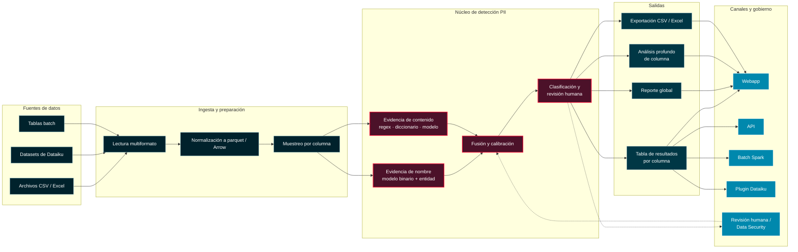
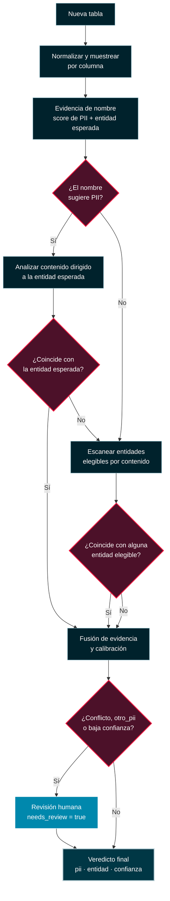
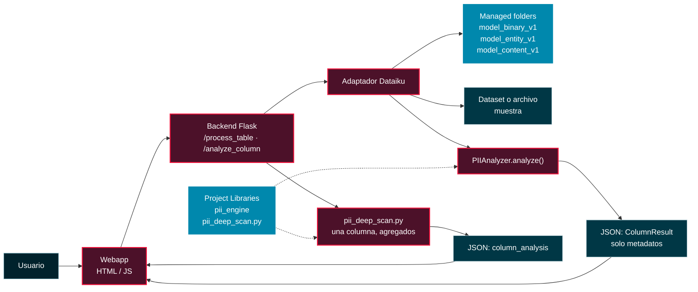
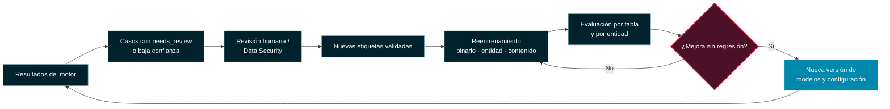

# Detección e identificación de datos PII — Visión ejecutiva

| Campo | Valor |
|---|---|
| Propósito | Presentación ejecutiva de la solución |
| Versión | 1.0 |
| Fecha | Noviembre 2026 |
| Clasificación | Interno |
| Fuente | `PII_Engine_Documentacion.md` v0.4 (2026-11-19) |
| Responsable | _(completar)_ |

> **Detalle técnico:** la arquitectura de componentes, los contratos de datos, el muestreo, los modelos y la API se documentan en la página hija «Motor PII — Documento técnico y de arquitectura».

> **Mensaje central:** la institución puede determinar qué datos personales contiene una tabla, en qué columnas se ubican y qué nivel de protección requieren, con un motor reutilizable, explicable y desplegado sobre Dataiku.

## 1. Resumen ejecutivo

- Detecta e identifica datos personales (PII) columna por columna en tablas de cualquier tamaño, sin procesar el 100% de los registros.
- Combina dos evidencias: el nombre de la columna y una muestra representativa de su contenido.
- Cubre 40 entidades con cuatro estrategias de detección y una ruta de revisión humana.
- Marca para revisión humana los casos ambiguos y entrega resultados explicables y trazables.
- Se despliega como webapp en Dataiku y comparte el mismo núcleo con API, batch y plugin.

## 2. Contexto y problema

Las áreas de negocio reciben tablas de múltiples fuentes y con estructuras heterogéneas. Determinar manualmente qué columnas contienen datos personales es costoso, inconsistente y no escala al volumen operativo.

El riesgo no es únicamente regulatorio. Una clasificación incompleta también limita el gobierno del dato, la aplicación de controles proporcionales y la capacidad de responder a revisiones de auditoría.

La institución requiere una capacidad reutilizable que:

- analice tablas nuevas de forma consistente;
- funcione con metadatos y con contenido;
- explique el motivo de cada decisión;
- escale sin depender del tamaño total de la tabla;
- y pueda integrarse en distintos canales de consumo.

## 3. Solución propuesta

Se propone un **motor agnóstico de procesamiento, detección e identificación de datos PII** que, para cada columna, determina si contiene PII, de qué entidad se trata y con qué confianza.

La arquitectura separa el núcleo de detección de los canales de consumo. El primer canal es una webapp estándar de Dataiku; el mismo núcleo puede invocarse desde API, procesos batch y plugins sin reescribir la lógica.

**Diagrama D1 — Vista ejecutiva de la solución.**



**Qué resuelve**

- Evita revisiones manuales completas: el análisis se concentra en la muestra y en los casos que requieren validación.
- Entrega una clasificación consistente y repetible para tablas nuevas.
- Aporta evidencia y confianza para priorizar la revisión.
- Permite reutilizar la misma capacidad en distintos procesos y canales.

## 4. Cómo funciona

El motor acumula evidencia antes de emitir un veredicto:

1. **Evidencia de nombre.** Un modelo binario estima si el nombre de la columna sugiere PII; un modelo de entidad propone el tipo esperado.
2. **Evidencia de contenido.** Sobre una muestra de valores se aplican regex con validador, diccionarios y un modelo de contenido.
3. **Fusión y calibración.** Las señales se combinan para producir `prob_pii`, `entity` y `prob_entity`.
4. **Revisión humana.** Los conflictos, los casos `otro_pii` y la baja confianza se marcan con `needs_review`.

**Diagrama D2 — Flujo de decisión.**



**Cobertura del catálogo**

| Grupo | Estrategia | Entidades |
|---|---|---:|
| A | Regex + validador (señal fuerte) | 11 |
| B | Regex débil o dependiente de contexto | 20 |
| C | Diccionario de valores | 4 |
| D | Modelo de contenido | 4 |
| E | Validación humana (`otro_pii`) | 1 |
| | **Total** | **40** |

**Análisis profundo de columna**

Es un camino separado y opcional. Analiza una sola columna, por chunks y con tope configurable, y devuelve únicamente agregados de cobertura y distribución. No modifica el veredicto principal ni expone valores originales.

## 5. Arquitectura y despliegue

La solución se organiza en cuatro capas:

- **Canales:** webapp, API, batch Spark y plugin de Dataiku.
- **Entrada y salida:** lectura multiformato, normalización y muestreo.
- **Núcleo:** orquestador, modelos de nombre, recognizers, fusión y calibración.
- **Artefactos:** modelos en managed folders y configuración versionada.

**Diagrama D3 — Despliegue en Dataiku.**



**Notas de despliegue**

- El backend es un adaptador delgado: resuelve entradas, modelos y salida; no contiene lógica de detección.
- Los modelos viven en los managed folders `model_binary_v1`, `model_entity_v1` y `model_content_v1`.
- El código del motor y del análisis profundo se carga en Project Libraries.
- La webapp usa el mismo code env que el motor.
- El frontend solo recibe metadatos y agregados; no recibe valores de la muestra.

## 6. Valor y diferenciadores

| Dimensión | Resultado |
|---|---|
| Escala | El costo del análisis depende de la muestra, no del total de registros. |
| Cobertura | 40 entidades: 39 detectables por contenido y 1 ruta de revisión humana. |
| Explicabilidad | Evidencia de nombre y contenido, confianza y marca de revisión. |
| Privacidad | No persiste valores; la muestra vive solo en memoria. |
| Reutilización | El mismo núcleo atiende webapp, API, batch y plugin. |
| Configurabilidad | Entidades, patrones, catálogos y umbrales viven en configuración versionada. |
| Trazabilidad | Cada resultado registra versión del motor, de los modelos y de la configuración. |
| Gobierno | Los casos ambiguos se derivan a revisión humana y a Data Security. |

## 7. Estado y roadmap

| Fase | Estado |
|---|---|
| 0. Modelos base | Completado |
| 1. Núcleo | Implementado |
| 2. Determinísticos y diccionarios | Implementado; falta calibrar abreviaturas con datos reales |
| 3. Integración de contenido | Implementado; pendiente smoke test con el bundle real |
| 4. Despliegue en Dataiku | Implementado en repositorio; pendiente cargar en DSS y smoke test |
| 4b. Análisis profundo | Implementado; pendiente smoke test y validación de umbrales |
| 5. Fusión y calibración | Pendiente |
| 6. Adaptadores restantes | Pendiente |
| 7. Producción | Pendiente |

**Lectura ejecutiva:** la capacidad principal está construida. El siguiente hito es el despliegue y la validación con artefactos reales en Dataiku; después, la calibración con datos reales y la industrialización.

## 8. Riesgos, mitigaciones y decisiones

| Riesgo | Mitigación |
|---|---|
| Etiquetas inconsistentes entre datasets | `cleanlab`, reglas de entidad y resolución documentada de conflictos. |
| Brecha entre datos sintéticos y reales | Negativos difíciles y evaluación con columnas reales. |
| Nombres de columna no vistos | Análisis de contenido y características de caracteres. |
| PII poco frecuente en texto libre | Detección de texto libre, cobertura reportada y análisis profundo. |
| Falsos positivos del modelo de contenido | Grupo D, umbral `tau`, bucket «Sin PII / Otro» e interpretación de prevalencia. |
| Costo de escanear una columna completa | Una columna a la vez, chunks y tope configurable. |
| `report.html` con valores reales | Restringir o anonimizar antes de compartir el managed folder. |

**Decisiones requeridas**

- Construir el conjunto de evaluación con columnas reales y calibrar pesos y umbrales.
- Validar con Compliance el mapeo de clasificación de las 40 entidades.
- Definir el control de acceso de la webapp.
- Confirmar el tope y el criterio del análisis profundo.
- Definir si el análisis profundo se exportará a CSV o Excel.
- Restringir o anonimizar el `report.html` antes de compartirlo.

## 9. Seguridad y gobierno

- **Sin persistencia de valores.** La muestra vive únicamente en memoria durante el análisis.
- **Logs sin datos.** Se registran nombres de tabla y columna, tamaños y scores; nunca valores.
- **Salida solo de metadatos.** Ningún `ColumnResult` incluye ejemplos de contenido.
- **Análisis profundo sin valores.** Solo devuelve cobertura, distribución y conteos.
- **Control de acceso.** Los adaptadores heredan los permisos del usuario o servicio sobre los datasets.
- **Trazabilidad.** Cada resultado registra versión del motor, de los modelos y de la configuración.
- **Validación externa.** Las etiquetas validadas por Data Security alimentan el ciclo de reentrenamiento.

## 10. Siguientes pasos y solicitudes

1. Cargar `pii_engine/` y `pii_deep_scan.py` en Project Libraries y desplegar la webapp en DSS.
2. Ejecutar el smoke test con los `model.pkl` reales de los tres managed folders.
3. Construir el conjunto de evaluación con columnas reales y calibrar la fusión.
4. Validar con Compliance la clasificación y los niveles de sensibilidad.
5. Definir el control de acceso y la política de retención de la muestra.
6. Restringir o anonimizar el `report.html`.
7. Confirmar el tope del análisis profundo y su exportación.

---

## Anexo A — Contrato de salida

Cada columna produce un objeto con veredicto, entidad, confianza, evidencia y versiones.

```json
{
  "table": "tabla_ejemplo",
  "column": "columna_ejemplo",
  "pii": true,
  "prob_pii": 0.97,
  "entity": "telefono",
  "prob_entity": 0.94,
  "evidence": "both",
  "match_rate": 0.91,
  "sample_size": 2000,
  "needs_review": false,
  "classification": 1,
  "engine_version": "0.1.0",
  "model_version": "bin:joblib,ent:joblib,content:v1",
  "config_version": "1.0",
  "schema_version": "1.0"
}
```

| Campo | Descripción |
|---|---|
| `pii` | Veredicto final booleano. |
| `prob_pii` | Probabilidad calibrada de que la columna contenga PII. |
| `entity` | Tipo de PII detectado. |
| `prob_entity` | Confianza en la entidad asignada. |
| `evidence` | Origen de la decisión: `name`, `content` o `both`. |
| `match_rate` | Fracción de la muestra que validó la entidad. |
| `sample_size` | Valores únicos no nulos analizados. |
| `needs_review` | Indica que se requiere revisión humana. |
| `classification` | 1 = detectable por contenido; 2 = ambigua, requiere revisión. |

**Endpoints de la webapp**

| Método | Ruta | Salida |
|---|---|---|
| `GET` | `/health` | Estado, versiones y límites. |
| `POST` | `/process_table` | Lista de `ColumnResult`. |
| `POST` | `/analyze_column` | Agregados del análisis profundo. |
| `POST` | `/export_xlsx` | Archivo Excel con resultados. |

## Anexo B — Catálogo de entidades

| Grupo | Estrategia | Entidades |
|---|---|---:|
| A | Regex + validador | 11 |
| B | Regex débil o dependiente de contexto | 20 |
| C | Diccionario de valores | 4 |
| D | Modelo de contenido | 4 |
| E | Validación humana | 1 |
| | **Total** | **40** |

El detalle de las 40 entidades, su método de contenido, contexto de nombre y nivel de sensibilidad se encuentra en la página hija «Catálogo de entidades» y en la sección 11 de `PII_Engine_Documentacion.md`.

## Anexo C — Métricas y estado técnico

| Aspecto | Valor |
|---|---|
| Modelo binario de nombre | 213.912 filas y 8.894 tablas de entrenamiento. |
| F1 global fuera de muestra | 0.973 (GroupKFold 5). |
| F1 en nombres no vistos | 0.389; justifica el análisis de contenido. |
| Umbral del modelo binario | 0.409. |
| Modelo de contenido | 4 entidades del Grupo D + clase interna `otro`; `tau=0.50`, `theta=0.30`. |
| Pruebas | 87 del motor, 9 del escáner y 2 del endpoint en verde. |
| Métricas del modelo de contenido | Pendientes de los valores reales de `report.html`. |

## Anexo D — Glosario

| Término | Definición |
|---|---|
| PII | Información de identificación personal. |
| Entidad | Tipo de PII: CURP, RFC, teléfono, nombre, etc. |
| Recognizer | Componente que puntúa si una muestra corresponde a una entidad. |
| Validador | Función que comprueba reglas estructurales o dígitos verificadores. |
| Contexto | Palabras del nombre de columna que refuerzan o reducen un score. |
| `needs_review` | Marca que indica revisión humana. |
| `otro_pii` | Entidad ambigua que se deriva a revisión humana. |
| Managed folder | Carpeta administrada de Dataiku donde viven los modelos. |
| Project Library | Librería de código Python del proyecto de Dataiku. |

## Anexo E — Ciclo de mejora continua

Los resultados con revisión o baja confianza alimentan un ciclo de reentrenamiento y evaluación antes de publicar una nueva versión.

**Diagrama D4 — Ciclo de mejora continua.**



## Referencias

- `p8/dataiku/PII_Engine_Documentacion.md` (v0.4, 2026-11-19).
- `p8/dataiku/tabla_entidades_pii.md`.
- `p8/dataiku/webapp_v2_3/` (frontend y backend actuales).
- `p8/dataiku/pii_engine/` y `p8/dataiku/pii_deep_scan.py`.
