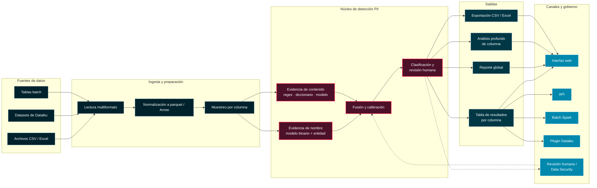
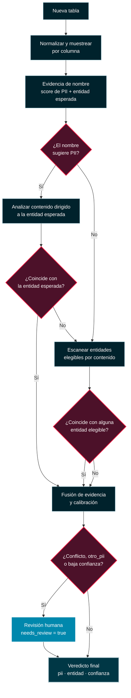
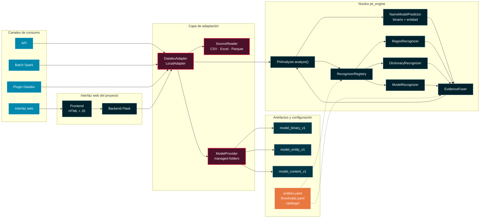
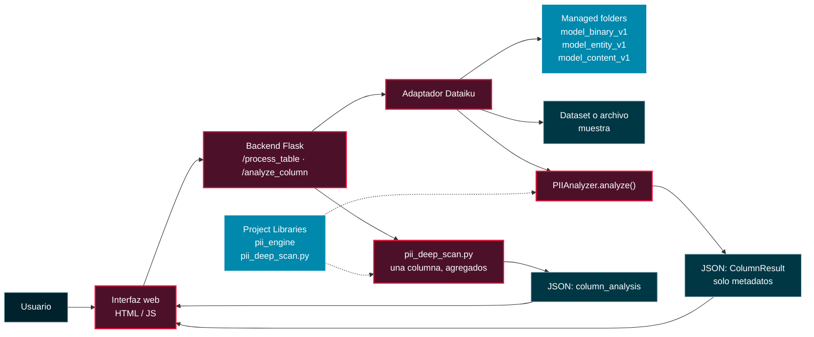
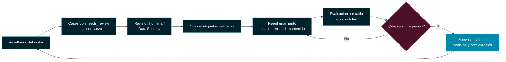
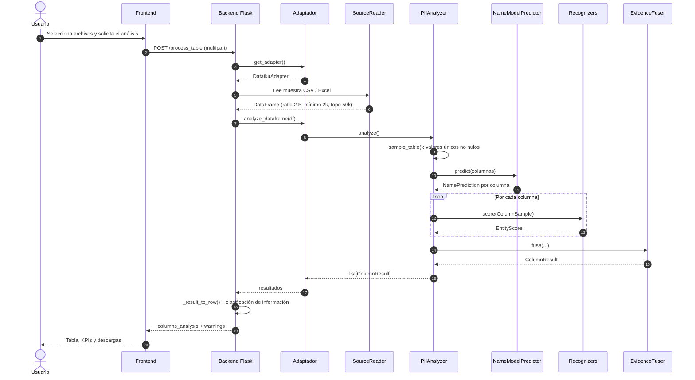
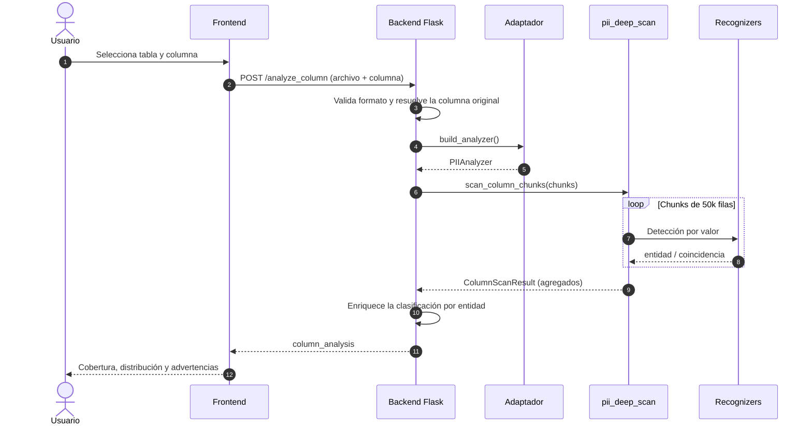
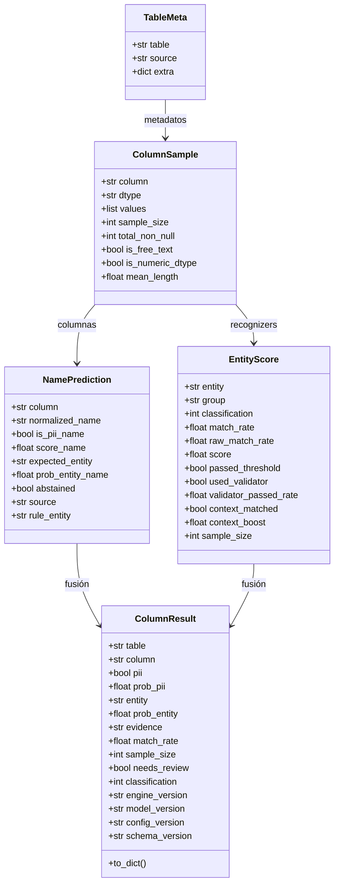

# Motor de detección e identificación de datos PII — Documento consolidado

| Campo | Valor |
|---|---|
| Propósito | Documento único ejecutivo-técnico del motor PII |
| Versión | 1.0 |
| Fecha | Noviembre 2026 |
| Clasificación | Interno |
| Proyecto Dataiku | **Dku Admin Project PII Identifier** |
| Iniciativa | DKU Admin Projects PII Identifier (columns+context), Sprint 12 |
| Fuentes | `PII_Engine_Documentacion.md` v0.4; reportes de modelos de noviembre de 2026; código de `pii_engine/`; `pii_deep_scan.py`; interfaz web del proyecto |
| Responsable | _(completar)_ |

> **Nota de identificación:** el proyecto de Dataiku creado para este fin se denomina **«Dku Admin Project PII Identifier»**. Este documento describe la capacidad, la arquitectura, el estado y las brechas del motor que reside en dicho proyecto.

> **Cómo leer este documento:** las secciones 1 a 6 están orientadas a dirección y comités; las secciones 7 a 19 y los anexos concentran el detalle técnico para arquitectura, datos y seguridad.

## Contenido

1. Resumen ejecutivo
2. Contexto y problema
3. Alcance y principios de diseño
4. Solución propuesta
5. Cómo funciona el motor
6. Catálogo de entidades
7. Arquitectura de componentes
8. Contratos de datos y API
9. Modelos, métricas y limitaciones
10. Muestreo y rendimiento
11. Análisis profundo de columna
12. Despliegue en Dataiku
13. Seguridad, privacidad y gobierno
14. Pruebas y validación
15. Operación y observabilidad
16. Estado, roadmap y brechas
17. Riesgos, mitigaciones y decisiones abiertas
18. Ciclo de mejora continua
19. Glosario
20. Anexos

---

## 1. Resumen ejecutivo

La institución puede determinar qué datos personales contiene una tabla, en qué columnas se ubican y qué nivel de protección requieren, con un motor reutilizable, explicable y desplegado sobre Dataiku.

- Detecta e identifica datos personales (PII) columna por columna en tablas de cualquier tamaño, sin procesar el 100 % de los registros.
- Combina dos evidencias: el nombre de la columna y una muestra representativa de su contenido.
- Cubre 40 entidades con cuatro estrategias de detección y una ruta de revisión humana.
- Marca para revisión humana los casos ambiguos y entrega resultados explicables y trazables.
- Expone la capacidad mediante una interfaz web del proyecto; el mismo núcleo puede invocarse desde API, procesos batch y plugins sin reescribir la lógica.
- No persiste valores: la muestra vive únicamente en memoria y la salida contiene solo metadatos.

**Indicadores principales**

| Dimensión | Resultado |
|---|---|
| Entidades del catálogo | 40: 39 detectables por contenido y 1 de revisión humana. |
| Modelos | Binario de nombre, entidad de nombre y contenido. |
| Cobertura por contenido sin nombre | 25 de 40 entidades. |
| Modelo binario de nombre | F1 fuera de muestra 0.980; umbral de operación 0.438. |
| Modelo de entidad de nombre | Macro F1 fuera de muestra 0.957 en 34 clases. |
| Modelo de contenido | Macro F1 fuera de muestra 0.982 en 5 clases. |
| Pruebas | 87 del motor, 9 del escáner profundo y 2 del endpoint, en verde. |
| Estado | Capacidad construida; pendiente el despliegue y el smoke test con artefactos reales, la calibración con columnas reales y la industrialización. |

**Lectura ejecutiva:** la capacidad principal está construida y documentada. El siguiente hito es validar el despliegue con los modelos reales en Dataiku; después, calibrar la fusión con columnas reales y avanzar a producción.

## 2. Contexto y problema

Las áreas de negocio reciben tablas de múltiples fuentes y con estructuras heterogéneas. Determinar manualmente qué columnas contienen datos personales es costoso, inconsistente y no escala al volumen operativo.

El riesgo no es únicamente regulatorio. Una clasificación incompleta también limita el gobierno del dato, la aplicación de controles proporcionales y la capacidad de responder a revisiones de auditoría.

La institución requiere una capacidad reutilizable que:

- analice tablas nuevas de forma consistente;
- funcione con metadatos y con contenido;
- explique el motivo de cada decisión;
- escale sin depender del tamaño total de la tabla;
- y pueda integrarse en distintos canales de consumo.

## 3. Alcance y principios de diseño

### 3.1 Alcance

- **Entrada:** tabla en Polars, pandas o diccionario; archivos CSV, Excel o parquet en los canales.
- **Salida:** `list[ColumnResult]` con `pii`, `prob_pii`, `entity`, `prob_entity`, `evidence`, `match_rate`, `sample_size`, `needs_review`, `classification` y versiones.
- **Núcleo agnóstico:** no lee archivos ni conoce el canal; recibe una muestra y metadatos.
- **Adaptadores delgados:** traducen entradas, resuelven modelos y serializan salidas.
- **Muestreo:** el costo depende de la muestra, no del total de filas.
- **Configuración externa:** entidades, patrones, catálogos y umbrales en YAML versionado.
- **Privacidad por diseño:** la muestra vive en memoria; no se persisten valores ni se registran en logs.
- **Análisis profundo opcional:** escaneo de una columna, por chunks y con tope configurable, que no modifica el veredicto principal.

### 3.2 Fuera de alcance

- Uso de LLM o modelos generativos en el camino crítico.
- Descarga de modelos preentrenados desde internet.
- Remediación, enmascaramiento o sustitución de los datos.
- Exportación de hallazgos del análisis profundo en la versión actual.
- Sustitución del veredicto principal por los resultados del análisis profundo.

### 3.3 Decisiones de diseño

| Decisión | Motivo |
|---|---|
| Sin Presidio ni spaCy | Alto consumo de recursos, inicialización pesada y modelos poco adecuados para valores sueltos de tabla. |
| Polars como motor de datos | Eficiencia en memoria y velocidad para regex y operaciones columnares. |
| Muestreo por columna | Se esperan tablas de millones de registros; el costo debe ser independiente del tamaño. |
| Formato interno parquet / Arrow | Un único formato de trabajo sin importar el formato de entrada. |
| Patrón Strategy para recognizers | Agregar o ajustar regex, diccionarios o modelos por entidad desde configuración. |
| PII determinístico → regex + validador | Entidades con estructura fija o dependiente de contexto. |
| PII de catálogo cerrado → diccionario | Entidades con valores acotados. |
| PII no determinístico → modelo de contenido | Entidades abiertas apoyadas en un modelo entrenado. |
| PII ambiguo → revisión humana | Entidades sin estructura única agrupadas en `otro_pii`. |
| Núcleo independiente del canal | El mismo `analyze()` se usa desde la interfaz web, API, Spark y plugin. |
| Artefactos en managed folders | Modelos versionados y resueltos en runtime por el adaptador. |
| Configuración del modelo de contenido dentro del bundle | `labels`, `temperature`, `tau` y `theta` viajan en `model.pkl`. |
| Código del motor en Project Libraries | El paquete `pii_engine` y el módulo `pii_deep_scan.py` se cargan en la librería del proyecto. |

## 4. Solución propuesta

Se propone un **motor agnóstico de procesamiento, detección e identificación de datos PII** que, para cada columna, determina si contiene PII, de qué entidad se trata y con qué confianza.

La arquitectura separa el núcleo de detección de los canales de consumo. El primer canal es la interfaz web del proyecto; el mismo núcleo puede invocarse desde API, procesos batch y plugins sin reescribir la lógica.

**Diagrama — Vista ejecutiva de la solución.**



**Qué resuelve**

- Evita revisiones manuales completas: el análisis se concentra en la muestra y en los casos que requieren validación.
- Entrega una clasificación consistente y repetible para tablas nuevas.
- Aporta evidencia y confianza para priorizar la revisión.
- Permite reutilizar la misma capacidad en distintos procesos y canales.

## 5. Cómo funciona el motor

El motor acumula evidencia antes de emitir un veredicto:

1. **Evidencia de nombre.** Un modelo binario estima si el nombre de la columna sugiere PII; un modelo de entidad propone el tipo esperado.
2. **Evidencia de contenido.** Sobre una muestra de valores se aplican regex con validador, diccionarios y un modelo de contenido.
3. **Fusión y calibración.** Las señales se combinan para producir `prob_pii`, `entity` y `prob_entity`.
4. **Revisión humana.** Los conflictos, los casos `otro_pii` y la baja confianza se marcan con `needs_review`.

**Diagrama — Flujo de decisión.**



### 5.1 Evidencia de nombre

- El modelo binario corre para todas las columnas.
- Si el nombre sugiere PII y coincide con una regla inequívoca, se evita el modelo de entidad mediante el fast path.
- El modelo de entidad solo se ejecuta para columnas que el binario marca como PII y que no resuelve el fast path.
- Las predicciones se cachean por nombre normalizado con LRU.
- Entidades con fast path: `curp`, `rfc`, `nss`, `ssn`, `correo`, `clave_elector`, `pasaporte`, `licencia_conducir`, `iban`, `clabe`, `cvv`, `coordenadas` y `fecha_vencimiento`.

### 5.2 Evidencia de contenido

Cada reconocedor devuelve un `EntityScore` con `match_rate`, `score`, `passed_threshold`, `used_validator` y contexto. Las estrategias son:

| Estrategia | Implementación | Uso |
|---|---|---|
| `regex` | `RegexRecognizer` | Grupos A y B; regex + validador + contexto. |
| `dictionary` | `DictionaryRecognizer` | Grupo C; catálogos cerrados. |
| `model` | `ModelRecognizer` | Grupo D; modelo de contenido. |
| `none` | `HumanReviewRecognizer` | `otro_pii`; deriva a revisión humana. |

Reglas de aplicación:

- Los patrones se aplican de forma vectorizada con Polars.
- Los validadores se ejecutan solo sobre los valores que hicieron match.
- En texto libre se usa búsqueda `contains`; en columnas estructuradas, `fullmatch`.
- El modelo de contenido se evalúa en una sola pasada por columna y se reutiliza para las cuatro entidades del Grupo D.
- Los valores `NULL_TOKENS` se descartan y los mayores a 120 caracteres se truncan antes de puntuar.

### 5.3 Fusión y calibración

La probabilidad se calcula con una función logit calibrada:

```text
prob_pii = sigmoid(
    w0
    + w1 * logit(score_nombre)
    + w2 * logit(match_rate_ajustado)
    + w3 * bonus_validador
)
```

- `clip(p, epsilon, 1 - epsilon)` evita indeterminaciones en `logit(0)` y `logit(1)`.
- `match_rate_ajustado` penaliza muestras pequeñas.
- El bono de validador se activa cuando hay un validador fuerte y `match_rate_ajustado > 0.5`.
- Algunas reglas aplican pisos explícitos para no degradar casos con evidencia fuerte.
- Para el Grupo D, la decisión de columna se toma con `aggregate_column(tau, theta)`: cada valor vota por su clase si `p >= tau`; se acepta la clase con cobertura `>= theta`; si ninguna llega, se devuelve `otro`.
- `tau`, `theta` y `temperature` viajan dentro del bundle `model_content_v1`.

### 5.4 Reglas de decisión

| Nombre | Contenido | Resultado | `evidence` |
|---|---|---|---|
| PII | Valida la entidad esperada | PII, entidad esperada | `both` |
| PII | Valida otra entidad elegible | PII, entidad del contenido; `needs_review` si es de otra familia | `content` |
| PII | Ninguna entidad valida | No PII con probabilidad reducida; `needs_review` si el nombre era de alta confianza | `content` |
| PII | Vacío o todo nulo | PII con baja confianza | `name` |
| No PII | Valida una entidad elegible | PII, entidad del contenido; `needs_review` si fue sin contexto | `content` |
| No PII | Ninguna entidad valida | No PII | `both` |
| No PII | Vacío o todo nulo | No PII con baja confianza | `name` |
| `otro_pii` | Cualquiera | `needs_review = true`, sin entidad forzada | `name` |
| Cualquiera | Modelo de contenido = `otro` | Sin entidad del Grupo D; se resuelve con las reglas restantes | `content` |

### 5.5 Cobertura y políticas de contexto

- Las entidades del Grupo A pueden declarar PII por contenido aunque el nombre sea opaco.
- Las entidades de los Grupos B, C y D requieren refuerzo o coherencia con el nombre, especialmente cuando el contexto es obligatorio.
- Las entidades de «solo nombre» (`cvv`, `pin_nip`, `saldo`, `credito`, `biometrico`) no disparan PII únicamente por contenido.
- Las 9 entidades `required` carecen de un validador fuerte y sus patrones se solapan; la política vigente no habilita `allow_content_without_name`.
- La cobertura por contenido sin nombre es de **25 de 40** entidades: 11 del Grupo A, 6 del B, 4 del C y 4 del D.

## 6. Catálogo de entidades

El catálogo vigente consta de **40 entidades**: 39 detectables por contenido y 1 orientada a revisión humana (`otro_pii`).

| Grupo | Estrategia de contenido | Clasificación | Entidades |
|---|---|---:|---:|
| A | Regex + validador (señal fuerte) | 1 | 11 |
| B | Regex débil o dependiente de contexto | 1 | 20 |
| C | Diccionario de valores | 1 | 4 |
| D | Modelo de contenido | 1 | 4 |
| E | Validación humana (`otro_pii`) | 2 | 1 |
| | **Total** | | **40** |

**Niveles de sensibilidad**

| Nivel | Entidades |
|---|---|
| PII Interno (`internal_pii`) | `nombre`, `apellido`, `direccion`, `telefono`, `correo`, `codigo_postal`, `ip`, `coordenadas`, `soeid`, `geid`, `cliente`, `lugar_nacimiento`, `estado_civil`, `puesto`, `nomina` |
| PII Confidencial (`confidential_pii`) | `curp`, `rfc`, `clave_elector`, `ssn`, `nss`, `pasaporte`, `licencia_conducir`, `cic`, `ocr`, `fecha_nacimiento`, `fecha_vencimiento`, `tarjeta`, `cvv`, `pin_nip`, `clabe`, `iban`, `cuenta`, `saldo`, `credito`, `otro_pii` |
| PII Sensible (`sensitive_pii`) | `biometrico`, `nacionalidad`, `sexo` |
| Confidencial (`confidential_information`) | `contrato` |
| Interno (`internal_information`) | `empresa` |

> El detalle de las 40 entidades, su método de contenido, contexto de nombre y nivel de sensibilidad se encuentra en el Anexo B.

## 7. Arquitectura de componentes

La solución se organiza en cuatro capas:

- **Canales:** interfaz web, API, batch Spark y plugin de Dataiku.
- **Entrada y salida:** lectura multiformato, normalización y muestreo.
- **Núcleo:** orquestador, modelos de nombre, recognizers, fusión y calibración.
- **Artefactos:** modelos en managed folders y configuración versionada.

**Diagrama — Componentes técnicos.**



| Componente | Responsabilidad | Implementación |
|---|---|---|
| Interfaz web | UI, filtros, KPIs, descargas y análisis profundo | Frontend de la interfaz web del proyecto |
| Backend Flask | Endpoints, validación, resolución de archivos y clasificación de información | Backend de la interfaz web del proyecto |
| Adaptador | Lectura de fuentes, resolución de managed folders y construcción del analizador | `pii_engine/adapters/dataiku_adapter.py` |
| Orquestador | Flujo por columna y composición de versiones | `pii_engine/core/analyzer.py` |
| Modelos de nombre | Predicción binaria y multiclase por nombre de columna | `pii_engine/core/name_models.py` |
| Registro de recognizers | Carga de `entities.yaml` y selección de candidatos | `pii_engine/recognizers/registry.py` |
| Recognizers | Evidencia por regex, diccionario o modelo | `pii_engine/recognizers/*.py` |
| Fusión | Reglas de decisión y calibración logit | `pii_engine/core/fusion.py` |
| Muestreo | Filas y valores únicos por columna | `pii_engine/core/row_sampling.py`, `pii_engine/core/sampling.py` |
| Análisis profundo | Escaneo por chunks de una columna | `pii_deep_scan.py` |
| Modelos | Artefactos `model.pkl` + `report.html` | Managed folders del flow |

**Principios de la arquitectura**

1. **El núcleo no lee archivos ni conoce el canal.** Recibe una muestra y metadatos, y devuelve `list[ColumnResult]`.
2. **Los adaptadores son delgados.** Solo traducen entradas y salidas de cada canal.
3. **Spark no es dependencia del núcleo.** Con muestreo, el volumen analizado es pequeño y cabe en memoria.
4. **Todo es configurable.** Entidades, patrones, validadores, palabras de contexto y umbrales viven en configuración versionada.

## 8. Contratos de datos y API

### 8.1 Resultado por columna (`ColumnResult`)

Cada columna produce un objeto con veredicto, entidad, confianza, evidencia y versiones.

```json
{
  "table": "tabla_ejemplo",
  "column": "columna_ejemplo",
  "pii": true,
  "prob_pii": 0.97,
  "entity": "telefono",
  "prob_entity": 0.94,
  "evidence": "both",
  "match_rate": 0.91,
  "sample_size": 2000,
  "needs_review": false,
  "classification": 1,
  "engine_version": "0.1.0",
  "model_version": "bin:joblib,ent:joblib,content:v1",
  "config_version": "1.0",
  "schema_version": "1.0"
}
```

| Campo | Tipo | Descripción |
|---|---|---|
| `table` | str | Tabla o archivo de origen. |
| `column` | str | Nombre de la columna. |
| `pii` | bool | Veredicto final. |
| `prob_pii` | float | Probabilidad calibrada de PII. |
| `entity` | str | Entidad detectada o `no aplica`. |
| `prob_entity` | float | Confianza en la entidad. |
| `evidence` | str | `name`, `content` o `both`. |
| `match_rate` | float | Fracción de la muestra que validó la entidad. |
| `sample_size` | int | Valores únicos no nulos analizados. |
| `needs_review` | bool | Requiere revisión humana. |
| `classification` | int | 1 = detectable por contenido; 2 = ambigua. |
| `engine_version` | str | Versión de `pii_engine`. |
| `model_version` | str | Versiones de los modelos binario, entidad y contenido. |
| `config_version` | str | Versión de la configuración. |
| `schema_version` | str | Versión del contrato. |

`ColumnResult.to_dict()` redondea `prob_pii`, `prob_entity` y `match_rate` a cuatro decimales. La salida nunca incluye valores de la muestra.

### 8.2 Contrato del análisis profundo

El análisis profundo es un contrato independiente. Responde a una solicitud explícita sobre una sola columna y devuelve únicamente agregados.

| Campo | Tipo | Descripción |
|---|---|---|
| `column` | str | Columna analizada. |
| `total_rows`, `rows_scanned` | int | Filas totales y escaneadas. |
| `truncated` | bool | Se alcanzó el tope configurado. |
| `non_empty_values`, `empty_values` | int | Celdas con y sin contenido. |
| `unique_values`, `unique_pii_values` | int | Valores únicos y únicos con PII. |
| `pii_values`, `pii_rate` | int, float | Celdas PII y su proporción. |
| `non_pii_values`, `non_pii_rate` | int, float | Bucket «Sin PII / Otro». |
| `entities` | list | `entity`, `group`, `classification`, `cells`, `distribution_rate`, `coverage_rate`, `used_validator`, `context_matched`. |
| `warnings` | list | Advertencias de truncamiento o columnas vacías. |
| `engine_version`, `model_version`, `config_version` | str | Trazabilidad. |

Reglas de interpretación:

- Cada celda PII se asigna a una entidad ganadora para que la distribución sume 100 %.
- La prioridad del ganador es: validador fuerte, contexto del nombre, Grupo A > C > B > D y confianza.
- La cobertura por entidad se calcula de forma independiente; una celda puede coincidir con más de una entidad.
- El análisis profundo no es una probabilidad ni una medida de confianza: reporta prevalencia de tipos en la columna.
- No se devuelven ni registran valores crudos.

### 8.3 Endpoints

| Método | Ruta | Entrada | Salida |
|---|---|---|---|
| `GET` | `/health` | — | Estado, versiones y límites. |
| `POST` | `/process_table` | Multipart: `file` (repetible), `sample_size` opcional | `columns_analysis` + `warnings` |
| `POST` | `/analyze_column` | Multipart: `file`, `column`, `source_file`, `source_index` | `column_analysis` |
| `POST` | `/export_xlsx` | JSON: `filename`, `header`, `rows` | Archivo XLSX |

**Errores**

- `400`: archivo ausente, formato no soportado o parámetros inválidos.
- `413`: archivo mayor al límite configurado.
- `500`: fallo inesperado durante el análisis.
- `503`: motor no disponible o artefacto de modelo no resoluble.

Formato de error:

```json
{
  "status": "error",
  "message": "Descripción del error"
}
```

### 8.4 Clasificación de información

El backend traduce la entidad a un nivel de clasificación (`classification_version = 1.0`):

| Nivel | Entidades |
|---|---|
| PII Interno (`internal_pii`) | `nombre`, `apellido`, `direccion`, `telefono`, `correo`, `codigo_postal`, `ip`, `coordenadas`, `soeid`, `geid`, `cliente`, `lugar_nacimiento`, `estado_civil`, `puesto`, `nomina` |
| PII Confidencial (`confidential_pii`) | `curp`, `rfc`, `clave_elector`, `ssn`, `nss`, `pasaporte`, `licencia_conducir`, `cic`, `ocr`, `fecha_nacimiento`, `fecha_vencimiento`, `tarjeta`, `cvv`, `pin_nip`, `clabe`, `iban`, `cuenta`, `saldo`, `credito`, `otro_pii` |
| PII Sensible (`sensitive_pii`) | `biometrico`, `nacionalidad`, `sexo` |
| Confidencial (`confidential_information`) | `contrato` |
| Interno (`internal_information`) | `empresa` |

Reglas:

- Si `needs_review` es verdadero o la entidad es `otro_pii`, se asigna `confidential_pii`.
- Una entidad desconocida también se asigna a `confidential_pii`.
- `empresa` y `contrato` se marcan con `classification_review = true`.

## 9. Modelos, métricas y limitaciones

| Modelo | Nivel | Técnica | Artefacto |
|---|---|---|---|
| Binario de nombre | Nombre de columna | LightGBM de 200 árboles con calibración isotónica de 2 folds | `model_binary_v1/model.pkl` |
| Entidad de nombre | Nombre de columna | Ensamble híbrido multiclase de 34 clases con calibración por temperatura | `model_entity_v1/model.pkl` |
| Contenido | Valores de la muestra | TF-IDF char/word + rasgos de forma + regresión logística calibrada | `model_content_v1/model.pkl` |

### 9.1 Modelo binario de nombre

| Métrica | Valor |
|---|---|
| Volumen de entrenamiento | 182,525 filas y 9,106 tablas; 51.4 % PII. |
| F1 fuera de muestra | 0.980 |
| Precisión | 0.989 |
| Recall | 0.971 |
| ROC AUC / PR AUC | 0.995 / 0.996 |
| F1 en nombres no vistos | 0.635 (precisión 0.707 / recall 0.577) |
| Umbral de operación | 0.438 |
| Calibración | Isotónica, 2 folds. |

La brecha entre el F1 global y el de nombres no vistos es el principal punto de mejora y justifica incorporar el análisis de contenido.

### 9.2 Modelo de entidad de nombre

| Métrica | Valor |
|---|---|
| Volumen de entrenamiento | 78,184 filas PII con entidad y 8,469 tablas. |
| Clases | 34 |
| Macro F1 fuera de muestra | 0.957 |
| Weighted F1 | 0.998 |
| Accuracy | 0.998 |
| Top 3 | 1.000 |
| Macro F1 en nombres no vistos | 0.673 (accuracy 0.917) |
| Temperatura | 0.725 |

El modelo de entidad cubre 34 clases; el resto del catálogo se resuelve con reglas determinísticas, diccionarios y la ruta de revisión humana.

### 9.3 Modelo de contenido

| Métrica | Valor |
|---|---|
| Volumen de entrenamiento | 1,027,606 filas (de 1,044,321 crudas; deduplicadas). |
| Clases | 5: `nombre`, `apellido`, `direccion`, `empresa` y `otro` interno. |
| Validación | `StratifiedGroupKFold` de 5 folds; 259,706 grupos (13.6 % de filas en grupos partidos). |
| Macro F1 fuera de muestra | 0.982 |
| Weighted F1 | 0.985 |
| Accuracy | 0.985 |
| Macro F1 con ruido | 0.952 |
| F1 por clase | `apellido` 0.957; `direccion` 1.000; `empresa` 0.990; `nombre` 0.966; `otro` 0.995. |
| Agregación por columna | `tau = 0.50`, `theta = 0.30`; pureza 1.000, Macro F1 1.000 y FPR de `otro` 0.0000 en simulación. |
| Calibración | Temperatura `T = 0.857`; ECE de 0.38 % a 0.04 %. |

Detalle del modelo de contenido:

- TF-IDF `char_wb` de 2 a 5 caracteres, máximo 400,000 features.
- TF-IDF de palabras de 1 a 2, máximo 100,000 features.
- Ocho rasgos de forma: longitud, tokens, longitud media, proporción de dígitos, letras, puntuación, grupos de dígitos y comas.
- Regresión logística con `C=4.0`, `class_weight="balanced"` y `max_iter=300`.
- Negativos difíciles: nombres de productos, catálogos operativos, códigos internos y descripciones cortas.

### 9.4 Limitaciones y estado de validación

- Los modelos se entrenaron con datos sintéticos, catálogos y algunos datos reales; la métrica por columna del modelo de contenido es una simulación.
- La fusión no está calibrada con columnas reales; los pesos actuales son una propuesta inicial.
- No existe todavía una evaluación end to end del sistema fusionado.
- `report.html` incluye el Top 50 de errores OOF con valores reales; debe restringirse o anonimizarse antes de compartir el managed folder.
- Se requiere validación independiente, evaluación con columnas reales y aprobación formal antes de considerar el modelo para producción.

## 10. Muestreo y rendimiento

**Muestreo de filas**

- Tamaño objetivo: `ceil(total_filas * row_ratio)`.
- `row_ratio` por defecto: `0.02` (2 %).
- Mínimo por defecto: `2,000` filas.
- Tope por defecto: `50,000` filas.
- El resultado nunca supera el total de filas.
- Modo `random` con semilla `42`; alternativa `head`.
- Para fuentes por chunks existe `reservoir_sample`, con memoria `O(k)`.

**Muestreo de columnas**

- Se eliminan nulos y se normalizan cadenas vacías.
- Se conservan valores únicos y se muestrean hasta `2,000` por defecto.
- `PII_COLUMN_SAMPLE_SIZE` permite cambiar el tamaño; `0`, `none` o vacío lo desactivan.
- La semilla es configurable y reproducible.

**Texto libre**

Se detecta con longitud media y número de tokens:

- `mean_length >= 48` y `mean_tokens >= 6.5`, o
- `long_share >= 0.35` y `mean_tokens >= 5.0`.

En texto libre se usa búsqueda `contains`; en columnas estructuradas, `fullmatch`.

**Complejidad**

- El núcleo trabaja sobre la muestra, no sobre la tabla completa.
- El análisis por columna es `O(n · R)`, donde `n` es el tamaño de la muestra y `R` el número de recognizers elegibles (≤ 39).
- El reservorio mantiene memoria constante respecto al total de filas.
- Spark no es dependencia del núcleo.

## 11. Análisis profundo de columna

El análisis profundo es un camino separado y opcional. Analiza una sola columna, por chunks y con tope configurable, y devuelve únicamente agregados de cobertura y distribución. No modifica el veredicto principal ni expone valores originales.

- `DeepScanOptions`: `max_rows=500000`, `chunk_size=50000`, `include_model=True`.
- Procesa una columna por tabla y por solicitud.
- Los chunks se leen del archivo original; no se materializa la tabla completa.
- La distribución es la proporción de celdas PII asignadas a cada entidad; no es una probabilidad.
- La cobertura se calcula sobre celdas no vacías y puede solaparse entre entidades.
- El resultado es informativo: no modifica `analyze()`, la fusión ni el veredicto principal.
- No se devuelven valores crudos ni se persiste el archivo.
- Se excluye `otro_pii`; las entidades `required` solo participan si el nombre de la columna aporta contexto.
- Las entidades `name_only` participan solo si el nombre coincide con su contexto y el valor cumple su patrón.
- Si se alcanza el tope, se marcan las primeras N filas y se devuelve `truncated=true`.

**Flujo de uso**

1. El usuario selecciona una tabla o archivo.
2. Selecciona una columna de esa tabla.
3. Solicita el análisis de contenido completo.
4. El backend relee solo esa columna y llama a `pii_deep_scan.scan_column_chunks()`.
5. La interfaz muestra cobertura, distribución y advertencias.

## 12. Despliegue en Dataiku

**Diagrama — Despliegue en Dataiku.**



**Requisitos de despliegue**

- Cargar `pii_engine/` y `pii_deep_scan.py` en Project Libraries.
- Mantener los managed folders `model_binary_v1`, `model_entity_v1` y `model_content_v1` en el flow.
- Usar el mismo code env para el motor y la interfaz web.
- Pegar el backend en la pestaña Python de la interfaz web del proyecto y el frontend en la pestaña Frontend.
- El backend detecta el `app` inyectado por DSS o crea uno local para pruebas.
- Si se actualiza `pii_deep_scan.py`, recargar la librería o reiniciar el backend.

**Resolución de modelos**

- Si el managed folder expone `get_path()`, se usa la ruta local.
- Si no, el adaptador descarga `model.pkl` a un directorio temporal.
- Los modelos se cachean en el adaptador y se reutilizan entre solicitudes.
- `ModelArtifactError` indica un problema de artefacto y se traduce a HTTP 503.

**Dependencias del code env**

`polars`, `scikit-learn`, `scipy`, `numpy`, `pandas`, `joblib`, `cloudpickle`, `lightgbm`, `PyYAML`, `faker` y `dataiku`. `matplotlib` es opcional. Todas se instalan desde Artifactory.

> El proyecto Dataiku del motor contiene la configuración, los managed folders y las librerías necesarias para operar la capacidad descrita en este documento.

## 13. Seguridad, privacidad y gobierno

- **Sin persistencia de valores.** La muestra vive únicamente en memoria durante el análisis.
- **Logs sin datos.** Se registran nombres de tabla y columna, tamaños y scores; nunca valores.
- **Salida solo de metadatos.** Ningún `ColumnResult` incluye ejemplos de contenido.
- **Análisis profundo sin valores.** Solo devuelve cobertura, distribución y conteos; el archivo se relee en la petición y no se persiste.
- **Control de acceso.** Los adaptadores heredan los permisos del usuario o servicio sobre los datasets.
- **Trazabilidad.** Cada resultado registra versión del motor, de los modelos, de la configuración y del esquema.
- **Validación externa.** Las etiquetas validadas por Data Security alimentan el ciclo de reentrenamiento.
- **Artefactos de entrenamiento.** El bundle `model.pkl` no contiene valores de entrenamiento; `report.html` sí incluye el Top 50 de errores OOF con valores reales y debe restringirse o anonimizarse antes de compartirse.

## 14. Pruebas y validación

- 87 pruebas del motor.
- 9 pruebas de `pii_deep_scan.py`.
- 2 pruebas del endpoint de análisis profundo.
- Validación de modelos de nombre con `GroupKFold` por tabla.
- Validación del modelo de contenido con `StratifiedGroupKFold` por token alfabético.
- Prueba de robustez con ruido: typos, truncado y letra duplicada.
- Pruebas de paridad entre el análisis profundo y el motor.
- Pendiente: conjunto de evaluación con columnas reales y métricas end to end del sistema fusionado.

**Metodología recomendada para evaluar cambios**

1. Separar por tabla para evitar fuga de información.
2. Medir precisión, recall y F1 por entidad.
3. Medir `otro_fpr` y recall por clase en el modelo de contenido.
4. Medir latencia y memoria por columna.
5. Comparar contra la versión vigente antes de publicar.

## 15. Operación y observabilidad

- `/health` devuelve `engine_ready`, versiones, límites y configuración de muestreo.
- Las advertencias de archivos parciales se devuelven en `warnings`.
- Los errores de artefacto se aíslan como HTTP 503.
- El backend procesa varios archivos y continúa si uno falla, salvo error de artefacto.
- `model_version` permite identificar la combinación de modelos usada en cada resultado.
- Se recomienda monitorear tasa de `needs_review`, distribución de entidades, latencia y errores 5xx.

## 16. Estado, roadmap y brechas

| Fase | Estado |
|---|---|
| 0. Modelos base | Completado |
| 1. Núcleo | Implementado |
| 2. Determinísticos y diccionarios | Implementado; falta calibrar abreviaturas con datos reales |
| 3. Integración de contenido | Implementado; pendiente smoke test con el bundle real |
| 4. Despliegue en Dataiku | Implementado en repositorio; pendiente cargar en DSS y smoke test |
| 4b. Análisis profundo | Implementado; pendiente smoke test y validación de umbrales |
| 5. Fusión y calibración | Pendiente |
| 6. Adaptadores restantes | Pendiente |
| 7. Producción | Pendiente |

**Brechas conocidas**

| Brecha | Estado |
|---|---|
| Calibración con columnas reales | Pendiente |
| Métricas end to end del sistema fusionado | Pendientes |
| `report.html` con valores reales | Abierto: restringir o anonimizar |
| Smoke test en DSS | Pendiente |
| Umbrales del análisis profundo | Pendiente de validación con negocio |
| Entidades `required` sin contexto | Limitación documentada |
| Cobertura por contenido sin nombre | 25/40; evaluar ampliación con datos reales |
| Adaptadores API, batch y plugin | Pendiente |
| Monitoreo y reentrenamiento | Pendiente de runbook y tablero de calidad |

**Lectura ejecutiva:** la capacidad principal está construida. El siguiente hito es el despliegue y la validación con artefactos reales en Dataiku; después, la calibración con datos reales y la industrialización.

## 17. Riesgos, mitigaciones y decisiones abiertas

| Riesgo | Mitigación |
|---|---|
| Etiquetas inconsistentes entre datasets | `cleanlab`, reglas de entidad y resolución documentada de conflictos. |
| Brecha entre datos sintéticos y reales | Negativos difíciles y evaluación con columnas reales. |
| Nombres de columna no vistos | Análisis de contenido y características de caracteres. |
| PII poco frecuente en texto libre | Detección de texto libre, cobertura reportada y análisis profundo. |
| Falsos positivos del modelo de contenido | Grupo D, umbral `tau`, bucket «Sin PII / Otro» e interpretación de prevalencia. |
| Costo de escanear una columna completa | Una columna a la vez, chunks y tope configurable. |
| `report.html` con valores reales | Restringir o anonimizar antes de compartir el managed folder. |
| Divergencia entre `pii_deep_scan.py` y el motor | Pruebas de paridad y encapsulamiento del módulo. |
| Dependencia de la validación de Data Security | Avanzar con datos disponibles y diseñar para incorporar etiquetas futuras. |

**Decisiones requeridas**

- Construir el conjunto de evaluación con columnas reales y calibrar pesos y umbrales.
- Validar con Compliance el mapeo de clasificación de las 40 entidades.
- Definir el control de acceso de la interfaz web.
- Confirmar el tope y el criterio del análisis profundo.
- Definir si el análisis profundo se exportará a CSV o Excel.
- Restringir o anonimizar el `report.html` antes de compartirlo.

## 18. Ciclo de mejora continua

Los resultados con revisión o baja confianza alimentan un ciclo de reentrenamiento y evaluación antes de publicar una nueva versión.

**Diagrama — Ciclo de mejora continua.**



El diseño acepta nuevas etiquetas de Data Security en cualquier momento, tanto para el modelo binario como para el de entidad, sin reestructurar los datasets. Para el modelo de contenido, las etiquetas validadas conservan el esquema `value, type` y su origen.

## 19. Glosario

| Término | Definición |
|---|---|
| PII | Información de identificación personal. |
| Entidad | Tipo de PII: CURP, RFC, teléfono, nombre, etc. |
| Recognizer | Componente que puntúa si una muestra corresponde a una entidad. |
| Validador | Función que comprueba reglas estructurales o dígitos verificadores. |
| Contexto | Palabras del nombre de columna que refuerzan o reducen un score. |
| `match_rate` | Fracción de valores de la muestra que validan una entidad. |
| `needs_review` | Marca que indica revisión humana. |
| `otro_pii` | Entidad ambigua que se deriva a revisión humana. |
| `otro` | Clase interna del modelo de contenido; no es `otro_pii`. |
| `tau` | Probabilidad mínima por valor para votar por su clase. |
| `theta` | Cobertura mínima de votos para aceptar una clase en la columna. |
| `temperature` | Parámetro de calibración que suaviza o agudiza las probabilidades. |
| `oof` | Predicciones out-of-fold usadas para calibrar y diagnosticar sin fuga. |
| Clasificación 1 | Entidades detectables por contenido con regex, diccionario o modelo. |
| Clasificación 2 | Entidades ambiguas (`otro_pii`) que requieren revisión humana. |
| Análisis profundo | Escaneo opcional de una columna completa para medir prevalencia y distribución. |
| Cobertura PII | Celdas con al menos una entidad PII / celdas no vacías. |
| Distribución por entidad | Celdas ganadoras de una entidad / celdas PII. |
| Entidad ganadora | Entidad asignada a una celda según prioridad. |
| `truncated` | Indica que el análisis profundo se detuvo en el tope de filas. |
| `source_index` | Posición del archivo en la carga original. |
| Fast path | Resolución directa por regla de nombre sin invocar el modelo de entidad. |
| Reservorio | Muestreo uniforme con memoria constante sobre chunks. |
| Managed folder | Carpeta administrada de Dataiku donde viven los modelos. |
| Project Library | Librería de código Python del proyecto de Dataiku. |

---

## 20. Anexos

### Anexo A — Contrato de salida completo

Cada columna analizada produce un objeto con veredicto, entidad, confianza, evidencia y versiones.

```json
{
  "table": "tabla_ejemplo",
  "column": "columna_ejemplo",
  "pii": true,
  "prob_pii": 0.97,
  "entity": "telefono",
  "prob_entity": 0.94,
  "evidence": "both",
  "match_rate": 0.91,
  "sample_size": 2000,
  "needs_review": false,
  "classification": 1,
  "engine_version": "0.1.0",
  "model_version": "bin:joblib,ent:joblib,content:v1",
  "config_version": "1.0",
  "schema_version": "1.0"
}
```

| Campo | Descripción |
|---|---|
| `pii` | Veredicto final booleano. |
| `prob_pii` | Probabilidad calibrada de que la columna contenga PII. |
| `entity` | Tipo de PII detectado; `no aplica` cuando no es PII. |
| `prob_entity` | Confianza en la entidad asignada. |
| `evidence` | Origen de la decisión: `name`, `content` o `both`. |
| `match_rate` | Fracción de la muestra que validó la entidad. |
| `sample_size` | Valores únicos no nulos analizados. |
| `needs_review` | Indica que se requiere revisión humana. |
| `classification` | 1 = detectable por contenido; 2 = ambigua. |
| `engine_version` | Versión del motor `pii_engine`. |
| `model_version` | Versiones de los modelos binario, entidad y contenido. |
| `config_version` | Versión de `entities.yaml` y `thresholds.yaml`. |
| `schema_version` | Versión del contrato de salida. |

> La salida no incluye valores de la muestra. Los valores analizados nunca se persisten ni se registran en logs.

### Anexo B — Catálogo completo de entidades

#### Grupo A — Regex + validador (11)

| Entidad | Método de contenido | Contexto de nombre | Nivel de sensibilidad |
|---|---|---|---|
| `curp` | Regex de 18 caracteres + validador | Opcional | Confidential PII |
| `rfc` | Regex de 12 o 13 caracteres + validador | Opcional | Confidential PII |
| `clave_elector` | Regex de 18 caracteres + validador | Opcional | Confidential PII |
| `clabe` | 18 dígitos + dígito verificador y banco | Opcional | Confidential PII |
| `iban` | País + dígitos + módulo 97 | Opcional | Confidential PII |
| `tarjeta` | 13 a 19 dígitos + Luhn y rango BIN | Opcional | Confidential PII |
| `correo` | Regex de correo + dominio | No | Internal PII |
| `ip` | IPv4 / IPv6 | No | Internal PII |
| `coordenadas` | Latitud / longitud con rangos válidos | Sí | Internal PII |
| `ssn` | `###-##-####` + prefijos válidos | Sí | Confidential PII |
| `nss` | 11 dígitos + validador IMSS | Sí | Confidential PII |

#### Grupo B — Regex débil o dependiente de contexto (20)

| Entidad | Método de contenido | Contexto de nombre | Nivel de sensibilidad |
|---|---|---|---|
| `telefono` | 10 dígitos (+52 opcional) | Sí | Internal PII |
| `codigo_postal` | 5 dígitos + catálogo o rango | Recomendado | Internal PII |
| `fecha_nacimiento` | Fecha + edad plausible | Obligatorio | Confidential PII |
| `fecha_vencimiento` | Fecha o `MM/AA` | Obligatorio | Confidential PII |
| `pasaporte` | Alfanumérico (formato por confirmar) | Sí | Confidential PII |
| `licencia_conducir` | Alfanumérico variable por estado | Obligatorio | Confidential PII |
| `soeid` | Patrón interno `[a-z]{2}\d{5}` | Sí | Internal PII |
| `geid` | Patrón numérico interno (por confirmar) | Recomendado | Internal PII |
| `cic` | 9 dígitos (INE, por confirmar) | Obligatorio | Confidential PII |
| `ocr` | 12 o 13 dígitos (INE/IFE, por confirmar) | Obligatorio | Confidential PII |
| `cuenta` | Numérico de longitud fija | Obligatorio | Confidential PII |
| `cliente` | ID numérico | Obligatorio | Internal PII |
| `contrato` | ID numérico o alfanumérico | Obligatorio | Confidential Information (con revisión) |
| `nomina` | ID numérico de empleado o nómina | Obligatorio | Internal PII |
| `cvv` | 3 o 4 dígitos | Obligatorio (solo nombre) | Confidential PII |
| `pin_nip` | 4 a 6 dígitos | Obligatorio (solo nombre) | Confidential PII |
| `saldo` | Numérico con decimales | Obligatorio (solo nombre) | Confidential PII |
| `credito` | Numérico | Obligatorio (solo nombre) | Confidential PII |
| `biometrico` | Blob, base64 o hash largo | Obligatorio (solo nombre) | Sensitive PII |
| `lugar_nacimiento` | Catálogo de estados y países | Recomendado | Internal PII |

#### Grupo C — Diccionario de valores (4)

| Entidad | Método de contenido | Contexto de nombre | Nivel de sensibilidad |
|---|---|---|---|
| `nacionalidad` | Diccionario de gentilicios y países | Sí | Sensitive PII |
| `sexo` | Diccionario de valores | Sí | Sensitive PII |
| `estado_civil` | Diccionario de valores | Sí | Internal PII |
| `puesto` | Diccionario o catálogo de puestos | Sí | Internal PII |

#### Grupo D — Modelo de contenido (4)

| Entidad | Método de contenido | Contexto de nombre | Nivel de sensibilidad |
|---|---|---|---|
| `nombre` | Modelo de contenido entrenado con catálogo PER | Sí | Internal PII |
| `apellido` | Modelo de contenido entrenado con catálogo de apellidos | Sí | Internal PII |
| `direccion` | Modelo de contenido con catálogo DIR y pistas léxicas | Sí | Internal PII |
| `empresa` | Modelo de contenido con catálogo ORG2 y sufijos societarios | Sí | Internal Information (con revisión) |

El bundle `model_content_v1` tiene cinco clases: `apellido`, `direccion`, `empresa`, `nombre` y `otro`. La clase `otro` es interna y no se reporta como entidad.

#### Grupo E — Validación humana (1)

| Entidad | Método de contenido | Contexto de nombre | Nivel de sensibilidad |
|---|---|---|---|
| `otro_pii` | Sin regex ni modelo; activa `needs_review` | Sí | Confidential PII (con revisión) |

#### Notas operativas del catálogo

- Las entidades de «solo nombre» no disparan PII únicamente por contenido.
- Las entidades con contexto obligatorio requieren coherencia con el nombre de la columna.
- `lugar_nacimiento` se evalúa con reglas y catálogo, no con el modelo de contenido.
- El análisis profundo excluye `otro_pii` y las entidades de «solo nombre»; las obligatorias solo participan si el nombre aporta contexto.
- La cobertura por contenido sin nombre es de 25 de 40 entidades.
- La validación formal del mapeo de sensibilidad con Compliance está pendiente.

### Anexo C — Umbrales y variables de entorno

**Configuración de muestreo y fusión**

```yaml
sampling:
  row_ratio: 0.02
  row_min_rows: 2000
  row_max_rows: 50000
  default_sample_size: 2000
  seed: 42
  free_text_mean_length: 48.0
  free_text_mean_tokens: 6.5

fusion:
  w0: -0.25
  w1: 0.55
  w2: 0.65
  w3: 0.90
  epsilon: 0.0001
  min_sample_for_full_weight: 50
  pii_decision_threshold: 0.50
  empty_content_damping: 0.72
  unconfirmed_name_damping: 0.35
```

**Variables de entorno**

| Variable | Default | Uso |
|---|---|---|
| `PII_BINARY_FOLDER` | `model_binary_v1` | Managed folder del modelo binario. |
| `PII_ENTITY_FOLDER` | `model_entity_v1` | Managed folder del modelo de entidad. |
| `PII_CONTENT_FOLDER` | `model_content_v1` | Managed folder del modelo de contenido. |
| `PII_MODEL_FILENAME` | `model.pkl` | Nombre del artefacto. |
| `PII_SAMPLE_RATIO` | `0.02` | Proporción de filas muestreadas. |
| `PII_SAMPLE_MIN_ROWS` | `2000` | Mínimo de filas. |
| `PII_MAX_READ_ROWS` | `50000` | Tope de filas leídas. |
| `PII_SAMPLING_MODE` | `random` | `random` o `head`. |
| `PII_SAMPLE_SEED` | `42` | Semilla de muestreo. |
| `PII_MAX_UPLOAD_MB` | `0` | Límite de carga; `0` = sin límite. |
| `PII_COLUMN_SAMPLE_SIZE` | `2000` | Valores únicos por columna; `0` = sin límite. |
| `PII_DEEP_MAX_ROWS` | `500000` | Tope del análisis profundo. |
| `PII_DEEP_CHUNK_SIZE` | `50000` | Tamaño de chunk. |
| `PII_DEEP_INCLUDE_MODEL` | `1` | Incluye el modelo D en el análisis profundo. |

### Anexo D — Mapa de componentes y archivos

| Ruta | Contenido |
|---|---|
| `pii_engine/core/analyzer.py` | Orquestador `PIIAnalyzer.analyze()`. |
| `pii_engine/core/fusion.py` | Reglas de decisión y calibración. |
| `pii_engine/core/name_models.py` | Modelos de nombre y fast path. |
| `pii_engine/core/sampling.py` | Muestreo de valores por columna. |
| `pii_engine/core/row_sampling.py` | Muestreo de filas y reservorio. |
| `pii_engine/core/schema.py` | Contratos de datos. |
| `pii_engine/recognizers/base.py` | Interfaz `Recognizer`. |
| `pii_engine/recognizers/registry.py` | Carga de `entities.yaml`. |
| `pii_engine/recognizers/regex_recognizer.py` | Regex + validador + contexto. |
| `pii_engine/recognizers/dictionary_recognizer.py` | Catálogos cerrados. |
| `pii_engine/recognizers/model_recognizer.py` | Modelo de contenido. |
| `pii_engine/adapters/dataiku_adapter.py` | Adaptadores y resolución de modelos. |
| `pii_engine/config/entities.yaml` | Catálogo y reglas. |
| `pii_engine/config/thresholds.yaml` | Umbrales y pesos. |
| `pii_deep_scan.py` | Análisis profundo por chunks. |
| Interfaz web — backend | Endpoints Flask de la interfaz web del proyecto. |
| Interfaz web — frontend | Lógica de la interfaz web del proyecto. |
| `modelos/recipe_binary_v1.py` | Entrenamiento del modelo binario. |
| `modelos/recipe_entity_v1.py` | Entrenamiento del modelo de entidad. |
| `modelos/recipe_content_v1.py` | Entrenamiento del modelo de contenido. |

### Anexo E — Secuencias y contratos

**Diagrama — Secuencia del proceso principal.**



**Diagrama — Secuencia del análisis profundo.**



**Diagrama — Contratos de datos.**



### Anexo F — Publicación en Confluence

1. Crear la página principal del espacio con el título «Motor de detección e identificación de datos PII — Documento consolidado».
2. Pegar el cuerpo de este documento con **Insertar > Markup > Markdown**, o usar el editor de Markdown si la instancia lo soporta.
3. Ajustar la ficha: responsable, fecha y clasificación «Interno».
4. Para los diagramas:
   - Si el espacio tiene la macro **Mermaid**, insertar una macro por diagrama y pegar el bloque correspondiente.
   - Si no existe la macro, exportar cada diagrama con `mermaid.live` o `mermaid-cli` y subirlo como imagen.
   - También se puede usar la app **draw.io** si el espacio la tiene habilitada.
5. Verificar que no se publiquen valores reales, muestras ni el Top 50 de errores OOF.
6. Si se requiere detalle adicional, crear páginas hijas con el catálogo, el contrato de datos y el roadmap; la página principal permanece como documento consolidado.

### Anexo G — Referencias

- `PII_Engine_Documentacion.md` v0.4 (2026-11-19).
- Reportes de modelos de noviembre de 2026 para `model_binary_v1`, `model_entity_v1` y `model_content_v1`.
- `p8/dataiku/tabla_entidades_pii.md`.
- `pii_engine/` y `pii_deep_scan.py`.
- Interfaz web del proyecto (frontend y backend).
- `modelos/recipe_binary_v1.py`, `recipe_entity_v1.py` y `recipe_content_v1.py`.
- Iniciativa DKU Admin Projects PII Identifier (columns+context), Sprint 12.
