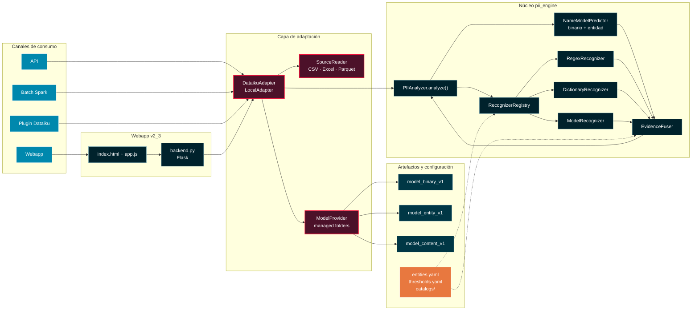
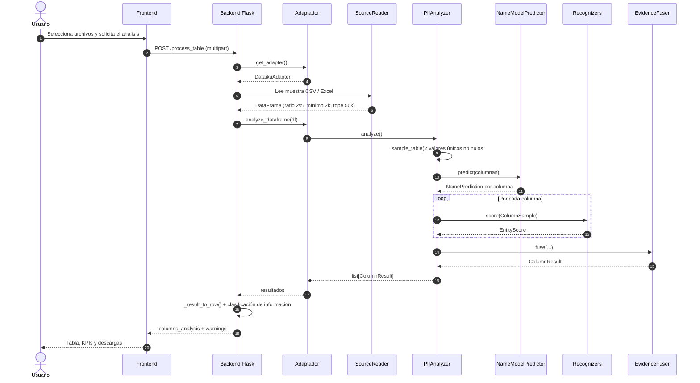
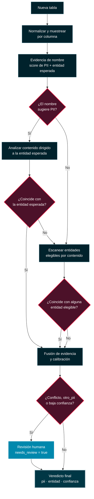
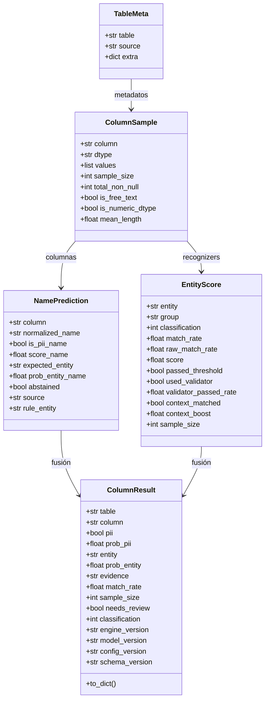
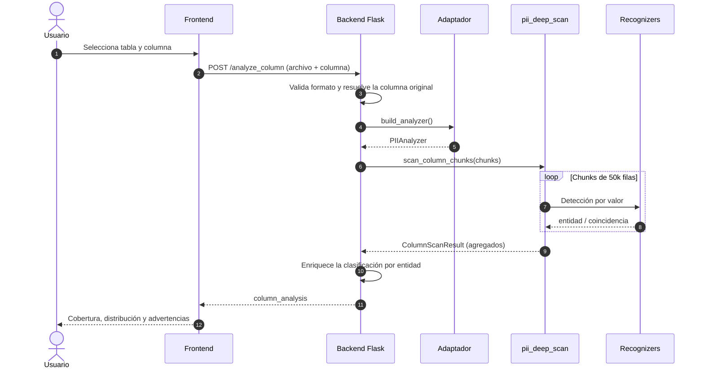
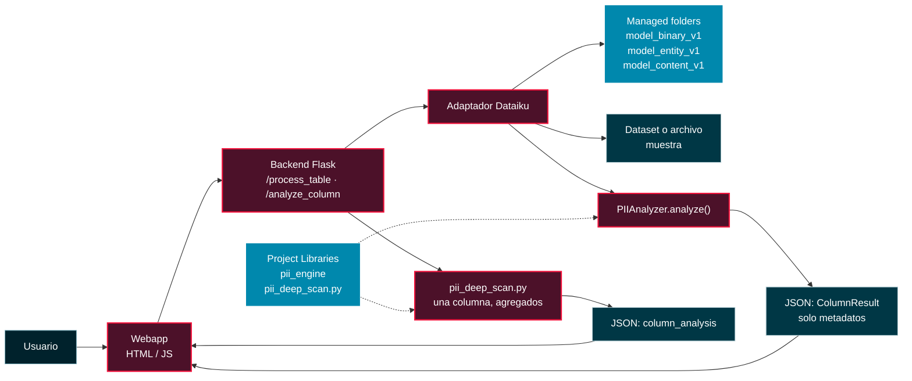

# Motor PII — Documento técnico y de arquitectura

| Campo | Valor |
|---|---|
| Propósito | Diseño técnico, arquitectura y operación del motor PII |
| Versión | 1.0 |
| Fecha | Noviembre 2026 |
| Clasificación | Interno |
| Audiencia | Arquitectura, Ingeniería de Datos, Seguridad, Data Security |
| Fuente | `PII_Engine_Documentacion.md` v0.4 y código de `pii_engine/`, `pii_deep_scan.py` y `webapp_v2_3/` |
| Responsable | _(completar)_ |

> **Resumen técnico:** `PIIAnalyzer` recibe una tabla o una muestra, resuelve evidencia por nombre y por contenido, fusiona las señales y devuelve un `ColumnResult` por columna. La webapp es un adaptador delgado sobre Dataiku; los modelos viven en managed folders y la configuración en YAML versionado. El motor no persiste valores y solo devuelve metadatos.

## 1. Alcance y principios de diseño

- **Entrada:** tabla en Polars, pandas o diccionario; archivos CSV, Excel o parquet en los adaptadores.
- **Salida:** `list[ColumnResult]` con `pii`, `prob_pii`, `entity`, `prob_entity`, `evidence`, `match_rate`, `sample_size`, `needs_review`, `classification` y versiones.
- **Núcleo agnóstico:** no lee archivos ni conoce el canal; recibe una muestra y metadatos.
- **Adaptadores delgados:** traducen entradas, resuelven modelos y serializan salidas.
- **Muestreo:** el costo depende de la muestra, no del total de filas.
- **Configuración externa:** entidades, patrones, catálogos y umbrales en YAML.
- **Privacidad por diseño:** la muestra vive en memoria; no se persisten valores ni se registran en logs.
- **Fuera de alcance (v0.4):** LLM, enmascaramiento/remediación, descarga de modelos preentrenados y exportación del análisis profundo.

## 2. Arquitectura de componentes



| Componente | Responsabilidad | Implementación |
|---|---|---|
| Frontend | UI, filtros, KPIs, descargas y análisis profundo | `webapp_v2_3/index.html`, `app.js`, `styles.css` |
| Backend Flask | Endpoints, validación, resolución de archivos y clasificación de información | `webapp_v2_3/backend.py` |
| Adaptador | Lectura de fuentes, resolución de managed folders y construcción del analizador | `pii_engine/adapters/dataiku_adapter.py` |
| Orquestador | Flujo por columna y composición de versiones | `pii_engine/core/analyzer.py` |
| Modelos de nombre | Predicción binaria y multiclase por nombre de columna | `pii_engine/core/name_models.py` |
| Registro de recognizers | Carga de `entities.yaml` y selección de candidatos | `pii_engine/recognizers/registry.py` |
| Recognizers | Evidencia por regex, diccionario o modelo | `pii_engine/recognizers/*.py` |
| Fusión | Reglas de decisión y calibración logit | `pii_engine/core/fusion.py` |
| Muestreo | Filas y valores únicos por columna | `core/row_sampling.py`, `core/sampling.py` |
| Análisis profundo | Escaneo por chunks de una columna | `pii_deep_scan.py` |
| Modelos | Artefactos `model.pkl` + `report.html` | Managed folders del flow |

## 3. Flujo principal de análisis



**Secuencia**

1. El frontend envía uno o más archivos a `POST /process_table`.
2. El backend valida la extensión y lee una muestra de filas con `read_csv_sample` o `read_excel_sample`.
3. `_prepare_dataframe` elimina columnas sin nombre y resuelve nombres duplicados con sufijos `_2`, `_3`, etc.
4. El adaptador construye el `PIIAnalyzer` con los bundles de modelo.
5. `PIIAnalyzer.analyze()` muestrea valores únicos por columna y predice nombre.
6. Se evalúa la entidad esperada y, si no supera el umbral, se escanean entidades elegibles por contenido.
7. `EvidenceFuser.fuse()` aplica las reglas y la calibración.
8. El backend agrega `source_file`, `source_index` y la clasificación de información; devuelve `columns_analysis` y advertencias.

## 4. Flujo de decisión del núcleo



| Nombre | Contenido | Resultado | `evidence` |
|---|---|---|---|
| PII | Valida la entidad esperada | PII, entidad esperada | `both` |
| PII | Valida otra entidad elegible | PII, entidad del contenido; `needs_review` si es de otra familia | `content` |
| PII | Ninguna entidad valida | No PII con probabilidad reducida; `needs_review` si el nombre era de alta confianza | `content` |
| PII | Vacío o todo nulo | PII con baja confianza | `name` |
| No PII | Valida una entidad elegible | PII, entidad del contenido; `needs_review` si fue sin contexto | `content` |
| No PII | Ninguna entidad valida | No PII | `both` |
| No PII | Vacío o todo nulo | No PII con baja confianza | `name` |
| `otro_pii` | Cualquiera | `needs_review = true`, sin entidad forzada | `name` |
| Cualquiera | Modelo de contenido = `otro` | Sin entidad del Grupo D; se resuelve con las reglas restantes | `content` |

## 5. Contratos de datos



`ColumnResult` es el contrato público del motor:

| Campo | Tipo | Descripción |
|---|---|---|
| `table` | str | Tabla o archivo de origen. |
| `column` | str | Nombre de la columna. |
| `pii` | bool | Veredicto final. |
| `prob_pii` | float | Probabilidad calibrada de PII. |
| `entity` | str | Entidad detectada o `no aplica`. |
| `prob_entity` | float | Confianza en la entidad. |
| `evidence` | str | `name`, `content` o `both`. |
| `match_rate` | float | Fracción de la muestra que validó la entidad. |
| `sample_size` | int | Valores únicos no nulos analizados. |
| `needs_review` | bool | Requiere revisión humana. |
| `classification` | int | 1 = detectable por contenido; 2 = ambigua. |
| `engine_version` | str | Versión de `pii_engine`. |
| `model_version` | str | Versiones de los modelos binario, entidad y contenido. |
| `config_version` | str | Versión de la configuración. |
| `schema_version` | str | Versión del contrato. |

Ejemplo de salida:

```json
{
  "table": "tabla_ejemplo",
  "column": "columna_ejemplo",
  "pii": true,
  "prob_pii": 0.97,
  "entity": "telefono",
  "prob_entity": 0.94,
  "evidence": "both",
  "match_rate": 0.91,
  "sample_size": 2000,
  "needs_review": false,
  "classification": 1,
  "engine_version": "0.1.0",
  "model_version": "bin:joblib,ent:joblib,content:v1",
  "config_version": "1.0",
  "schema_version": "1.0"
}
```

`ColumnResult.to_dict()` redondea `prob_pii`, `prob_entity` y `match_rate` a cuatro decimales. La salida nunca incluye valores de la muestra.

**Contrato del análisis profundo**

| Campo | Tipo | Descripción |
|---|---|---|
| `column` | str | Columna analizada. |
| `total_rows`, `rows_scanned` | int | Filas totales y escaneadas. |
| `truncated` | bool | Se alcanzó el tope configurado. |
| `non_empty_values`, `empty_values` | int | Celdas con y sin contenido. |
| `unique_values`, `unique_pii_values` | int | Valores únicos y únicos con PII. |
| `pii_values`, `pii_rate` | int, float | Celdas PII y su proporción. |
| `non_pii_values`, `non_pii_rate` | int, float | Bucket «Sin PII / Otro». |
| `entities` | list | `entity`, `group`, `classification`, `cells`, `distribution_rate`, `coverage_rate`, `used_validator`, `context_matched`. |
| `warnings` | list | Advertencias de truncamiento o columnas vacías. |
| `engine_version`, `model_version`, `config_version` | str | Trazabilidad. |

## 6. Fusión de evidencia y calibración

La probabilidad se calcula con una función logit calibrada:

```text
prob_pii = sigmoid(
    w0
    + w1 * logit(score_nombre)
    + w2 * logit(match_rate_ajustado)
    + w3 * bonus_validador
)
```

Parámetros vigentes en `pii_engine/config/thresholds.yaml`:

| Parámetro | Valor | Uso |
|---|---:|---|
| `w0` | -0.25 | Intercepto. |
| `w1` | 0.55 | Peso de la evidencia de nombre. |
| `w2` | 0.65 | Peso de la evidencia de contenido. |
| `w3` | 0.90 | Bono por validador fuerte. |
| `epsilon` | 0.0001 | Estabilización del logit. |
| `min_sample_for_full_weight` | 50 | Muestra mínima para peso completo. |
| `pii_decision_threshold` | 0.50 | Umbral base de decisión. |
| `empty_content_damping` | 0.72 | Amortiguamiento sin contenido. |
| `unconfirmed_name_damping` | 0.35 | Amortiguamiento cuando el contenido no confirma el nombre. |

Detalles de implementación:

- `adjust_match_rate` penaliza muestras pequeñas con `sqrt(sample_size / 50)`.
- El bono de validador se activa cuando hay un validador fuerte y `match_rate_ajustado > 0.5`.
- Algunas reglas aplican pisos explícitos (0.51, 0.55, 0.65, 0.75, 0.80) para no degradar casos con evidencia fuerte.
- La calibración con columnas reales sigue pendiente; los pesos actuales son una propuesta inicial.

**Resolución de nombre**

- El modelo binario corre para todas las columnas (`binary_gate_enabled: true`).
- Si el nombre sugiere PII y coincide con una regla inequívoca, se evita el modelo de entidad (`fast_path_enabled: true`).
- `fast_path_min_confidence`: 0.85; `entity_min_confidence`: 0.45.
- `cache_size`: 4096 predicciones de nombre.
- Entidades con fast path: `curp`, `rfc`, `nss`, `ssn`, `correo`, `clave_elector`, `pasaporte`, `licencia_conducir`, `iban`, `clabe`, `cvv`, `coordenadas` y `fecha_vencimiento`.

## 7. Muestreo y rendimiento

**Muestreo de filas**

- Tamaño objetivo: `ceil(total_filas * row_ratio)`.
- `row_ratio` por defecto: `0.02` (2%).
- Mínimo por defecto: `2.000` filas.
- Tope por defecto: `50.000` filas.
- El resultado nunca supera el total de filas.
- Modo `random` con semilla `42`; alternativa `head`.
- Para fuentes por chunks existe `reservoir_sample`, con memoria `O(k)`.

**Muestreo de columnas**

- Se eliminan nulos y se normalizan cadenas vacías.
- Se conservan valores únicos y se muestrean hasta `2.000` por defecto.
- `PII_COLUMN_SAMPLE_SIZE` permite cambiar el tamaño; `0`, `none` o vacío lo desactivan.
- La semilla es configurable y reproducible.

**Texto libre**

Se detecta con longitud media y número de tokens:

- `mean_length >= 48` y `mean_tokens >= 6.5`, o
- `long_share >= 0.35` y `mean_tokens >= 5.0`.

En texto libre se usa búsqueda `contains`; en columnas estructuradas, `fullmatch`.

**Complejidad**

- El núcleo trabaja sobre la muestra, no sobre la tabla completa.
- El análisis por columna es `O(n · R)`, donde `n` es el tamaño de la muestra y `R` el número de recognizers elegibles (≤ 39).
- El reservorio mantiene memoria constante respecto al total de filas.
- Spark no es dependencia del núcleo.

## 8. Recognizers y catálogo

La interfaz `Recognizer` implementa el patrón Strategy (`pii_engine/recognizers/base.py`). Cada recognizer devuelve un `EntityScore` con `match_rate`, `score`, `passed_threshold`, `used_validator` y contexto.

| Estrategia | Implementación | Uso |
|---|---|---|
| `regex` | `RegexRecognizer` | Grupos A y B; regex + validador + contexto. |
| `dictionary` | `DictionaryRecognizer` | Grupo C; catálogos cerrados. |
| `model` | `ModelRecognizer` | Grupo D; modelo de contenido. |
| `none` | `HumanReviewRecognizer` | `otro_pii`; deriva a revisión humana. |

El registro se carga desde `entities.yaml` (`pii_engine/recognizers/registry.py`). El motor selecciona candidatos con `get_scannable_recognizers`, que excluye `otro_pii` y las entidades `name_only` salvo que se solicite lo contrario.

| Grupo | Estrategia | Entidades |
|---|---|---:|
| A | Regex + validador | 11 |
| B | Regex débil o dependiente de contexto | 20 |
| C | Diccionario | 4 |
| D | Modelo de contenido | 4 |
| E | Revisión humana | 1 |
| | **Total** | **40** |

Puntos de extensión:

- Agregar una entidad: declararla en `entities.yaml` y, si aplica, añadir patrón, validador o catálogo.
- Agregar una estrategia: implementar `Recognizer` y registrar la nueva rama en `RecognizerRegistry.load()`.
- Ajustar contexto: `context_words`, `negative_context_words`, `context_mode`.
- Ajustar precisión: `min_match_rate`, `validator`, `allow_in_free_text`.

## 9. Modelos y artefactos

| Modelo | Nivel | Técnica | Artefacto |
|---|---|---|---|
| Binario de nombre | Nombre de columna | TF-IDF char/word + regresión logística o LightGBM; calibración isotónica | `model_binary_v1/model.pkl` |
| Entidad de nombre | Nombre de columna | Ensamble híbrido multiclase de 40 entidades; calibración por temperatura | `model_entity_v1/model.pkl` |
| Contenido | Valores de la muestra | TF-IDF char/word + rasgos de forma + regresión logística calibrada | `model_content_v1/model.pkl` |

**Modelo binario de nombre**

- 213.912 filas y 8.894 tablas de entrenamiento.
- F1 global fuera de muestra: 0.973.
- F1 en nombres no vistos: 0.389.
- Umbral: 0.409.
- La brecha en nombres no vistos es la justificación principal del análisis de contenido.

**Modelo de contenido**

- Clases: `nombre`, `apellido`, `direccion`, `empresa` y `otro` interno.
- TF-IDF `char_wb` de 2 a 5 caracteres (máximo 400.000 features).
- TF-IDF de palabras de 1 a 2 (máximo 100.000 features).
- Ocho rasgos de forma: longitud, tokens, longitud media, proporción de dígitos, letras, puntuación, grupos de dígitos y comas.
- Validación con `StratifiedGroupKFold` agrupando por el token alfabético más largo.
- Agregación por columna con `tau=0.50` y `theta=0.30`.
- El bundle incluye `labels`, `temperature`, `tau`, `theta` y `model_version`.

**Artefactos**

- `model_binary_v1`, `model_entity_v1` y `model_content_v1` son managed folders del flow.
- Cada uno publica `model.pkl` y `report.html`.
- Los bundles usan cloudpickle by-value; no requieren módulos custom en Project Libraries.
- Los modelos se resuelven en runtime; no se copian al repositorio de la webapp.

## 10. Análisis profundo de columna



- `DeepScanOptions`: `max_rows=500000`, `chunk_size=50000`, `include_model=True`.
- Procesa una columna por tabla y por solicitud.
- Los chunks se leen del archivo original; no se materializa la tabla completa.
- La distribución es la proporción de celdas PII asignadas a cada entidad; no es una probabilidad.
- La cobertura se calcula sobre celdas no vacías y puede solaparse entre entidades.
- El resultado es informativo: no modifica `analyze()`, la fusión ni el veredicto principal.
- No se devuelven valores crudos ni se persiste el archivo.

## 11. Despliegue en Dataiku



**Requisitos de despliegue**

- Cargar `pii_engine/` y `pii_deep_scan.py` en Project Libraries.
- Mantener los managed folders `model_binary_v1`, `model_entity_v1` y `model_content_v1` en el flow.
- Usar el mismo code env para el motor y la webapp.
- Pegar `webapp_v2_3/backend.py` en la pestaña Python de la webapp y el frontend en la pestaña Frontend.
- El backend detecta el `app` inyectado por DSS o crea uno local para pruebas.
- Si se actualiza `pii_deep_scan.py`, recargar la librería o reiniciar el backend.

**Resolución de modelos**

- Si el managed folder expone `get_path()`, se usa la ruta local.
- Si no, el adaptador descarga `model.pkl` a un directorio temporal.
- Los modelos se cachean en el adaptador y se reutilizan entre solicitudes.
- `ModelArtifactError` indica un problema de artefacto y se traduce a HTTP 503.

## 12. API y contratos de endpoint

| Método | Ruta | Entrada | Salida |
|---|---|---|---|
| `GET` | `/health` | — | Estado, versiones y límites. |
| `POST` | `/process_table` | Multipart: `file` (repetible), `sample_size` opcional | `columns_analysis` + `warnings` |
| `POST` | `/analyze_column` | Multipart: `file`, `column`, `source_file`, `source_index` | `column_analysis` |
| `POST` | `/export_xlsx` | JSON: `filename`, `header`, `rows` | Archivo XLSX |

**Ejemplo de solicitud principal**

```http
POST /process_table
Content-Type: multipart/form-data

file=@tabla.csv
sample_size=2000
```

**Ejemplo de respuesta principal**

```json
{
  "status": "success",
  "columns_analysis": [
    {
      "source_file": "tabla.csv",
      "source_index": 0,
      "dataset": "tabla.csv",
      "name": "columna_ejemplo",
      "is_pii": true,
      "pii_probability": 0.97,
      "entity": "telefono",
      "entity_probability": 0.94,
      "needs_review": false,
      "evidence": "both",
      "match_rate": 0.91,
      "sample_size": 2000,
      "model_version": "bin:joblib,ent:joblib,content:v1",
      "classification_version": "1.0",
      "information_classification": "internal_pii",
      "information_classification_group": "internal",
      "information_classification_label": "PII Interno",
      "classification_review": false,
      "classification_reason": "entity"
    }
  ],
  "classification_version": "1.0"
}
```

**Errores**

- `400`: archivo ausente, formato no soportado o parámetros inválidos.
- `413`: archivo mayor al límite configurado.
- `500`: fallo inesperado durante el análisis.
- `503`: motor no disponible o artefacto de modelo no resoluble.

Formato de error:

```json
{
  "status": "error",
  "message": "Descripción del error"
}
```

**Clasificación de información**

El backend traduce la entidad a un nivel de clasificación (`classification_version = 1.0`):

| Nivel | Entidades |
|---|---|
| PII Interno (`internal_pii`) | `nombre`, `apellido`, `direccion`, `telefono`, `correo`, `codigo_postal`, `ip`, `coordenadas`, `soeid`, `geid`, `cliente`, `lugar_nacimiento`, `estado_civil`, `puesto`, `nomina` |
| PII Confidencial (`confidential_pii`) | `curp`, `rfc`, `clave_elector`, `ssn`, `nss`, `pasaporte`, `licencia_conducir`, `cic`, `ocr`, `fecha_nacimiento`, `fecha_vencimiento`, `tarjeta`, `cvv`, `pin_nip`, `clabe`, `iban`, `cuenta`, `saldo`, `credito`, `otro_pii` |
| PII Sensible (`sensitive_pii`) | `biometrico`, `nacionalidad`, `sexo` |
| Confidencial (`confidential_information`) | `contrato` |
| Interno (`internal_information`) | `empresa` |

Reglas:

- Si `needs_review` es verdadero o la entidad es `otro_pii`, se asigna `confidential_pii`.
- Una entidad desconocida también se asigna a `confidential_pii`.
- `empresa` y `contrato` se marcan con `classification_review = true`.

## 13. Seguridad, privacidad y gobierno

- **Sin persistencia de valores:** la muestra vive en memoria.
- **Logs sin datos:** se registran nombres de tabla/columna, tamaños y scores.
- **Salida solo de metadatos:** ningún `ColumnResult` incluye ejemplos.
- **Análisis profundo sin valores:** solo agregados.
- **Control de acceso:** los adaptadores heredan permisos de Dataiku.
- **Trazabilidad:** `engine_version`, `model_version`, `config_version`, `schema_version` y `classification_version`.
- **`report.html`:** el reporte del modelo de contenido incluye el Top 50 de errores OOF con valores reales; debe restringirse o anonimizarse antes de compartir el managed folder.
- **Validación externa:** las etiquetas de Data Security alimentan el ciclo de reentrenamiento.

## 14. Pruebas y validación

- 87 pruebas del motor.
- 9 pruebas de `pii_deep_scan.py`.
- 2 pruebas del endpoint de análisis profundo.
- Validación de modelos de nombre con `GroupKFold` por tabla.
- Validación del modelo de contenido con `StratifiedGroupKFold` por token alfabético.
- Prueba de robustez con ruido: typos, truncado y letra duplicada.
- Pruebas de paridad entre el análisis profundo y el motor.
- Pendiente: conjunto de evaluación con columnas reales y métricas del modelo de contenido.

**Metodología recomendada para evaluar cambios**

1. Separar por tabla para evitar fuga de información.
2. Medir precisión, recall y F1 por entidad.
3. Medir `otro_fpr` y recall por clase en el modelo de contenido.
4. Medir latencia y memoria por columna.
5. Comparar contra la versión vigente antes de publicar.

## 15. Operación y observabilidad

- `/health` devuelve `engine_ready`, versiones, límites y configuración de muestreo.
- Las advertencias de archivos parciales se devuelven en `warnings`.
- Los errores de artefacto se aíslan como HTTP 503.
- El backend procesa varios archivos y continúa si uno falla, salvo error de artefacto.
- `model_version` permite identificar la combinación de modelos usada en cada resultado.
- Se recomienda monitorear tasa de `needs_review`, distribución de entidades, latencia y errores 5xx.

## 16. Brechas, riesgos y roadmap técnico

| Brecha o riesgo | Estado | Acción |
|---|---|---|
| Calibración con columnas reales | Pendiente | Construir conjunto de evaluación y calibrar pesos. |
| Métricas del modelo de contenido | Pendiente | Extraer valores reales de `report.html`. |
| `report.html` con valores reales | Abierto | Restringir o anonimizar. |
| Smoke test en DSS | Pendiente | Cargar librerías y webapp; ejecutar con bundles reales. |
| Umbrales del análisis profundo | Pendiente | Validar con negocio la interpretación de cobertura y distribución. |
| Entidades `required` sin contexto | Limitación | Documentar exclusión y evaluar modo exhaustivo futuro. |
| Cobertura por contenido sin nombre | 25/40 | Evaluar ampliación con datos reales. |
| Adaptadores API, batch y plugin | Pendiente | Implementar en fases posteriores. |
| Monitoreo y reentrenamiento | Pendiente | Definir runbook y tablero de calidad. |

## Anexo A — Configuración de umbrales

```yaml
sampling:
  row_ratio: 0.02
  row_min_rows: 2000
  row_max_rows: 50000
  default_sample_size: 2000
  seed: 42
  free_text_mean_length: 48.0
  free_text_mean_tokens: 6.5

fusion:
  w0: -0.25
  w1: 0.55
  w2: 0.65
  w3: 0.90
  epsilon: 0.0001
  min_sample_for_full_weight: 50
  pii_decision_threshold: 0.50
  empty_content_damping: 0.72
  unconfirmed_name_damping: 0.35
```

## Anexo B — Ejemplo de entidad en `entities.yaml`

```yaml
telefono:
  classification: 1
  group: B
  strategy: regex
  patterns:
    - '^(?:\+?52\s*)?(?:\(?\d{2,3}\)?[\s\-]?)?\d{3,4}[\s\-]?\d{4}$'
  validator: telefono_rules
  context_words: [telefono, tel, celular, cel, movil, phone, whatsapp, fax, numtel, numcel, lada]
  negative_context_words: [extension, ext, extn, folio, cuenta, cliente, contrato, geid]
  context_mode: recommended
  min_match_rate: 0.65
```

## Anexo C — Variables de entorno

| Variable | Default | Uso |
|---|---|---|
| `PII_BINARY_FOLDER` | `model_binary_v1` | Managed folder del modelo binario. |
| `PII_ENTITY_FOLDER` | `model_entity_v1` | Managed folder del modelo de entidad. |
| `PII_CONTENT_FOLDER` | `model_content_v1` | Managed folder del modelo de contenido. |
| `PII_MODEL_FILENAME` | `model.pkl` | Nombre del artefacto. |
| `PII_SAMPLE_RATIO` | `0.02` | Proporción de filas muestreadas. |
| `PII_SAMPLE_MIN_ROWS` | `2000` | Mínimo de filas. |
| `PII_MAX_READ_ROWS` | `50000` | Tope de filas leídas. |
| `PII_SAMPLING_MODE` | `random` | `random` o `head`. |
| `PII_SAMPLE_SEED` | `42` | Semilla de muestreo. |
| `PII_MAX_UPLOAD_MB` | `0` | Límite de carga; `0` = sin límite. |
| `PII_COLUMN_SAMPLE_SIZE` | `2000` | Valores únicos por columna; `0` = sin límite. |
| `PII_DEEP_MAX_ROWS` | `500000` | Tope del análisis profundo. |
| `PII_DEEP_CHUNK_SIZE` | `50000` | Tamaño de chunk. |
| `PII_DEEP_INCLUDE_MODEL` | `1` | Incluye el modelo D en el análisis profundo. |

## Anexo D — Mapa de archivos

| Ruta | Contenido |
|---|---|
| `pii_engine/core/analyzer.py` | Orquestador `PIIAnalyzer.analyze()`. |
| `pii_engine/core/fusion.py` | Reglas de decisión y calibración. |
| `pii_engine/core/name_models.py` | Modelos de nombre y fast path. |
| `pii_engine/core/sampling.py` | Muestreo de valores por columna. |
| `pii_engine/core/row_sampling.py` | Muestreo de filas y reservorio. |
| `pii_engine/core/schema.py` | Contratos de datos. |
| `pii_engine/recognizers/base.py` | Interfaz `Recognizer`. |
| `pii_engine/recognizers/registry.py` | Carga de `entities.yaml`. |
| `pii_engine/recognizers/regex_recognizer.py` | Regex + validador + contexto. |
| `pii_engine/recognizers/dictionary_recognizer.py` | Catálogos cerrados. |
| `pii_engine/recognizers/model_recognizer.py` | Modelo de contenido. |
| `pii_engine/adapters/dataiku_adapter.py` | Adaptadores y resolución de modelos. |
| `pii_engine/config/entities.yaml` | Catálogo y reglas. |
| `pii_engine/config/thresholds.yaml` | Umbrales y pesos. |
| `pii_deep_scan.py` | Análisis profundo por chunks. |
| `webapp_v2_3/backend.py` | Endpoints Flask. |
| `webapp_v2_3/app.js` | Lógica del frontend. |
| `modelos/recipe_binary_v1.py` | Entrenamiento del modelo binario. |
| `modelos/recipe_entity_v1.py` | Entrenamiento del modelo de entidad. |
| `modelos/recipe_content_v1.py` | Entrenamiento del modelo de contenido. |

## Anexo E — Glosario técnico

| Término | Definición |
|---|---|
| Recognizer | Componente que puntúa una muestra contra una entidad. |
| `match_rate` | Fracción de valores de la muestra que validan la entidad. |
| `passed_threshold` | Indica si el score superó el umbral de la entidad. |
| `needs_review` | Requiere validación humana. |
| `evidence` | Fuente de la decisión: nombre, contenido o ambos. |
| `other` / `otro` | Clase interna del modelo de contenido; no es `otro_pii`. |
| Managed folder | Carpeta administrada de Dataiku para artefactos. |
| Project Library | Librería Python del proyecto de Dataiku. |
| Fast path | Resolución directa por regla de nombre sin invocar el modelo de entidad. |
| Reservorio | Muestreo uniforme con memoria constante sobre chunks. |

## Referencias

- `p8/dataiku/PII_Engine_Documentacion.md` (v0.4, 2026-11-19).
- `p8/dataiku/tabla_entidades_pii.md`.
- `p8/dataiku/pii_engine/`.
- `p8/dataiku/pii_deep_scan.py`.
- `p8/dataiku/webapp_v2_3/backend.py`, `app.js`, `index.html`.
- `p8/dataiku/modelos/recipe_binary_v1.py`, `recipe_entity_v1.py`, `recipe_content_v1.py`.
